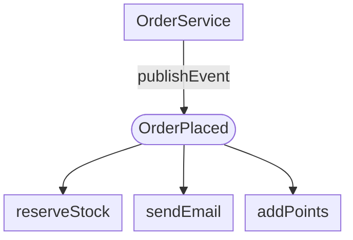
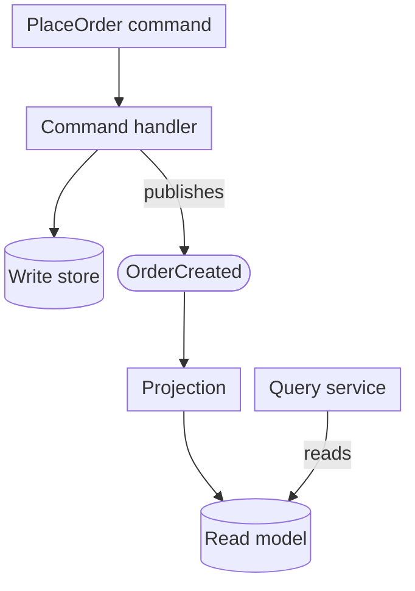
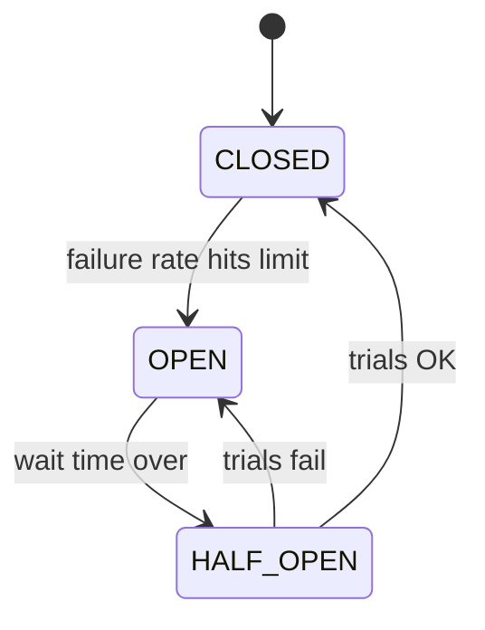

This post was inspired by Cloud X Berry's video [“10 Backend Design Pattern Laws of Senior Engineers and Architects”](https://www.facebook.com/reel/1863959601445893/). It runs through ten patterns in about 14 minutes, using e-commerce and payment examples. Here I go through the same ten patterns more slowly. For each one I cover the problem it solves, a short Java example built on the video's scenarios, when not to use it, and how Spring already gives it to you.

All the code is Java 21 with Spring Boot 3.5. Every snippet comes from a small Maven project that compiles, and 21 JUnit tests cover all ten patterns. Those include `@SpringBootTest` tests for the event and circuit-breaker examples and a Spring Data JPA + H2 test for the repository. The snippets below are trimmed: imports, packages and some getters are left out.

The payment providers are simulated, so nothing here calls Stripe, Razorpay or PayPal. Definitions are cited to their sources. Library defaults are cited to the Spring and Resilience4j documentation.

## A quick map

Seven of the ten come from the 1994 “Gang of Four” (GoF) book, *Design Patterns: Elements of Reusable Object-Oriented Software* by Gamma, Helm, Johnson and Vlissides: Factory (Method), Singleton, Strategy, Observer, Builder, Adapter and Decorator. The book catalogues 23 patterns in all ([Wikipedia: Design Patterns](https://en.wikipedia.org/wiki/Design_Patterns)). Repository comes from Martin Fowler's *Patterns of Enterprise Application Architecture* ([Fowler: Repository](https://martinfowler.com/eaaCatalog/repository.html)). CQRS and Circuit Breaker are architecture patterns from the 2000s, and Fowler has written about both ([Fowler: CQRS](https://martinfowler.com/bliki/CQRS.html), [Fowler: CircuitBreaker](https://martinfowler.com/bliki/CircuitBreaker.html)).

| Pattern | Problem in one line | Spring gives you |
|---|---|---|
| Repository | Business code tangled with SQL | Spring Data repositories |
| Factory | `if/else` over concrete classes everywhere | (plain Java is enough) |
| Singleton | Expensive shared object created many times | Singleton-scoped beans |
| Strategy | Growing `if/else` over business rules | Beans or records you choose between |
| Observer | One action must trigger many side effects | `ApplicationEventPublisher`, `@EventListener` |
| Builder | Constructors with many optional fields | (records + a nested builder) |
| Adapter | Third-party API shape leaks into your code | (plain Java is enough) |
| Decorator | Cross-cutting behaviour mixed into core logic | AOP proxies |
| CQRS | One model can't serve heavy reads and complex writes | Events between the two sides |
| Circuit Breaker | A dead dependency drags your service down with it | Resilience4j `@CircuitBreaker` |

## 1. Repository: keep SQL out of business logic

**The problem.** The video's example is a customer and their orders. If checkout code builds SQL strings, every rule change touches database code, and you can't unit test the rules without a database.

Fowler defines a Repository as something that “mediates between the domain and data mapping layers using a collection-like interface for accessing domain objects” ([Fowler: Repository](https://martinfowler.com/eaaCatalog/repository.html)). The same page says it helps minimize duplicate query logic. It also gives a clean separation, with a one-way dependency from the domain to the data mapping layer.

**In Spring you mostly don't write the implementation.** In Spring Data the central interface is `Repository`, a marker interface. `CrudRepository` and `ListCrudRepository` add CRUD methods, and `JpaRepository` adds JPA-specific ones ([Spring Data JPA: Core concepts](https://docs.spring.io/spring-data/jpa/reference/repositories/core-concepts.html)). Spring creates a proxy that implements your interface. It also derives queries from method names like `findByCustomerId` ([Spring Data JPA: Defining query methods](https://docs.spring.io/spring-data/jpa/reference/repositories/query-methods-details.html)).

```java
@Entity
public class CustomerOrder {
    @Id @GeneratedValue
    private Long id;
    private String customerId;
    private BigDecimal total;

    protected CustomerOrder() { } // required by JPA

    public CustomerOrder(String customerId, BigDecimal total) {
        this.customerId = customerId;
        this.total = total;
    }
    // getters omitted
}

// No implementation class: Spring Data creates one at startup.
public interface OrderRepository extends JpaRepository<CustomerOrder, Long> {

    // Derived query: Spring Data builds the JPQL from the method name.
    List<CustomerOrder> findByCustomerId(String customerId);
}
```

The service holds the business rule and nothing else:

```java
@Service
public class CheckoutService {

    private final OrderRepository orders;

    public CheckoutService(OrderRepository orders) {
        this.orders = orders;
    }

    @Transactional
    public CustomerOrder placeOrder(String customerId, BigDecimal total) {
        if (total.signum() <= 0) {
            throw new IllegalArgumentException("Order total must be positive");
        }
        return orders.save(new CustomerOrder(customerId, total));
    }
}
```

That separation is what makes testing cheap. One test uses `@DataJpaTest` against H2 to prove the derived query really works. Another uses a Mockito mock of `OrderRepository` to check that an order with a zero total is rejected before any database call is made.

**When not to use it, and pitfalls.**

- **A leaky repository.** Returning JPA-specific types or lazy proxies to the web layer moves database concerns back into the places you meant to protect.
- **The generic repository on top of Spring Data.** Wrapping `JpaRepository` in your own `GenericRepository<T>` usually adds a layer without adding meaning.
- **Treating it as a cache.** A repository is still a database call. `findAll()` on a big table is still a full table scan.
- **Very small apps.** For a script or a tiny service, `JdbcTemplate` in one class can be the simpler and more honest choice.

## 2. Factory: one place that knows which class to create

**The problem.** The video's example is a payment service that starts with Stripe, then adds Razorpay, then PayPal. If `new StripeProvider()` is scattered across the codebase, every new provider means hunting down every `if` and `new`.

A note on names. The GoF *Factory Method* is: “Define an interface for creating an object, but let subclasses decide which class to instantiate. Factory method lets a class defer instantiation to subclasses” ([Wikipedia: Factory method pattern](https://en.wikipedia.org/wiki/Factory_method_pattern), quoting GoF). What most backend code calls a “factory”, and what the video describes, is simpler: one method that maps an input to a concrete class. The goal is the same, though: callers depend on an interface, and one place decides which implementation to create.

Java 21 makes the simple version tidy. A sealed interface lists every allowed provider, and a `switch` expression maps configuration to an instance:

```java
public sealed interface PaymentProvider
        permits StripeProvider, RazorpayProvider, PayPalProvider {

    String name();

    // Simulated: a real provider would call the gateway's API here.
    String charge(BigDecimal amount, String currency);
}

public record RazorpayProvider() implements PaymentProvider {
    public String name() { return "razorpay"; }

    public String charge(BigDecimal amount, String currency) {
        return "pay_" + currency + "_" + amount.toPlainString();
    }
}

public final class PaymentProviderFactory {

    private PaymentProviderFactory() { }

    // The one place that knows which class backs which provider name.
    public static PaymentProvider forName(String configured) {
        return switch (configured.toLowerCase(Locale.ROOT)) {
            case "stripe"   -> new StripeProvider();
            case "razorpay" -> new RazorpayProvider();
            case "paypal"   -> new PayPalProvider();
            default -> throw new IllegalArgumentException(
                    "Unknown payment provider: " + configured);
        };
    }
}
```

The caller now only writes `PaymentProviderFactory.forName(config.provider()).charge(amount, "INR")`. Adding a fourth provider changes the `permits` list and one `case`. The `default` branch makes a typo in configuration fail loudly instead of silently falling back.

**When not to use it, and pitfalls.**

- **One implementation.** A factory for a single class is just indirection. Add it when the second implementation arrives.
- **Factories that do too much.** A factory chooses and creates. If it also validates business rules, calls the network and caches results, it has become a service with a misleading name.
- **Fighting the container.** In a Spring app, if the providers are beans with their own dependencies, let Spring build them. Then select among the injected beans, rather than calling `new` in a factory and wiring dependencies by hand.

## 3. Singleton: one shared instance, and why Spring changed the question

**The problem.** The video's examples are a configuration manager, a logger and a cache manager. These are objects that are expensive to build, or that must be shared, so you want one of them. The GoF Singleton ensures a class has one instance and provides a global point of access to it ([Wikipedia: Singleton pattern](https://en.wikipedia.org/wiki/Singleton_pattern)).

In plain Java, an `enum` with a single constant is a compact way to write one:

```java
public enum IdGenerator {
    INSTANCE;

    private final AtomicLong next = new AtomicLong(1);

    public long nextId() {
        return next.getAndIncrement();
    }
}
```

**In Spring, you almost never write that.** Singleton is the default bean scope: the container creates one shared instance per bean definition ([Spring: Bean scopes](https://docs.spring.io/spring-framework/reference/core/beans/factory-scopes.html)). The same page points out the difference from the GoF version. A GoF singleton hard-codes one instance per `ClassLoader`, while a Spring singleton is one instance per container per bean definition. So this is a singleton without any static state:

```java
@Component
public class PricingConfig {

    private final BigDecimal taxRate = new BigDecimal("0.18");

    public BigDecimal taxRate() {
        return taxRate;
    }
}
```

The test checks that `context.getBean(PricingConfig.class)` returns the same object as the one injected into the test. The difference matters in tests: you can replace a Spring bean with a fake, but you can't easily swap out `IdGenerator.INSTANCE`.

**When not to use it, and pitfalls.**

- **Global mutable state.** This is the video's main warning. A singleton that holds per-request or per-user data is shared by every thread at the same time. The Spring docs give the rule of thumb: use the prototype scope for stateful beans and the singleton scope for stateless ones ([Spring: Bean scopes](https://docs.spring.io/spring-framework/reference/core/beans/factory-scopes.html)).
- **A prototype inside a singleton.** If you inject a prototype-scoped bean into a singleton, the dependency is resolved only once, when the singleton is created ([Spring: Bean scopes](https://docs.spring.io/spring-framework/reference/core/beans/factory-scopes.html)). You get one instance, not a new one per use.
- **Static access in a DI app.** `Foo.getInstance()` hides a dependency that constructor injection would make visible.

## 4. Strategy: swap business rules without `if/else` sprawl

**The problem.** The video's example is discounts: premium users get one discount, students get another, and festival sales have their own. Written as one growing `if/else`, every new campaign edits the same method. In Strategy, a family of algorithms is encapsulated so they are interchangeable and can be selected at runtime, independently of the clients that use them ([Wikipedia: Strategy pattern](https://en.wikipedia.org/wiki/Strategy_pattern)).

Sealed interfaces and records make each rule a small, immutable value:

```java
public sealed interface DiscountStrategy {

    BigDecimal apply(BigDecimal subtotal);

    record Premium() implements DiscountStrategy {
        public BigDecimal apply(BigDecimal subtotal) {
            return percentOff(subtotal, 10);
        }
    }

    record Student() implements DiscountStrategy {
        public BigDecimal apply(BigDecimal subtotal) {
            return percentOff(subtotal, 15);
        }
    }

    // Festival sale: flat amount off, but never below zero.
    record Festival(BigDecimal flatOff) implements DiscountStrategy {
        public BigDecimal apply(BigDecimal subtotal) {
            return subtotal.subtract(flatOff).max(BigDecimal.ZERO);
        }
    }

    record NoDiscount() implements DiscountStrategy {
        public BigDecimal apply(BigDecimal subtotal) {
            return subtotal;
        }
    }

    private static BigDecimal percentOff(BigDecimal subtotal, int percent) {
        BigDecimal factor = BigDecimal.valueOf(100 - percent)
                .divide(BigDecimal.valueOf(100));
        return subtotal.multiply(factor).setScale(2, RoundingMode.HALF_UP);
    }
}
```

Choosing a strategy is kept separate from running it:

```java
public record Customer(String id, Tier tier) {
    public enum Tier { REGULAR, PREMIUM, STUDENT }
}

public class PriceCalculator {

    public static DiscountStrategy strategyFor(Customer customer, boolean festivalSale) {
        if (festivalSale) {
            return new DiscountStrategy.Festival(new BigDecimal("200"));
        }
        return switch (customer.tier()) {
            case PREMIUM -> new DiscountStrategy.Premium();
            case STUDENT -> new DiscountStrategy.Student();
            case REGULAR -> new DiscountStrategy.NoDiscount();
        };
    }

    public BigDecimal total(BigDecimal subtotal, DiscountStrategy strategy) {
        return strategy.apply(subtotal);
    }
}
```

The `switch` over the enum has no `default`. If someone adds a `Tier`, the code stops compiling until the new tier gets a rule. Each strategy is also tested on its own: a ₹1,000 subtotal gives ₹900 for premium and ₹850 for students. The festival discount takes ₹200 off but never goes below zero.

**In Spring**, if a strategy needs dependencies (a rate service, a feature flag), make each one a bean and choose among them at runtime. Stateless strategies like these can stay plain records.

**When not to use it, and pitfalls.**

- **Two stable branches.** An `if` that has had two cases for three years doesn't need a type hierarchy.
- **The selection logic is the hard part.** Strategy moves the *rules* apart. The question of *which rule applies* (stacking discounts, priority between campaigns) still needs a home, and it's often the part that grows. Keep it in one explicit place like `strategyFor`.
- **Money.** Whatever the pattern, use `BigDecimal` and an explicit rounding mode for prices, never `double`.

## 5. Observer: one event, many independent reactions

**The problem.** In the video, an order is placed and then inventory must update, an email goes out, loyalty points are added, analytics records the sale and a coupon may be issued. If `placeOrder()` calls all five, it depends on all five, and adding a sixth means editing checkout. Observer defines a one-to-many dependency: when the subject changes state, all its dependents are notified ([Wikipedia: Observer pattern](https://en.wikipedia.org/wiki/Observer_pattern)).



The pattern itself is small. Here it is in plain Java:

```java
public class PlainObserver {

    private final List<Consumer<OrderPlaced>> observers = new CopyOnWriteArrayList<>();

    public void subscribe(Consumer<OrderPlaced> observer) {
        observers.add(observer);
    }

    public void publish(OrderPlaced event) {
        observers.forEach(o -> o.accept(event));
    }
}
```

**Spring has it built in.** The Spring reference describes `ApplicationEventPublisher` with `ApplicationListener` as “essentially … the standard Observer design pattern”. Since Spring 4.2 you can publish any object as an event, not only subclasses of `ApplicationEvent` ([Spring: Standard and custom events](https://docs.spring.io/spring-framework/reference/core/beans/context-introduction.html#context-functionality-events)). So the event is a record:

```java
public record OrderPlaced(String orderId, String customerId, BigDecimal total) { }

@Service
public class OrderService {

    private final ApplicationEventPublisher events;

    public OrderService(ApplicationEventPublisher events) {
        this.events = events;
    }

    public String placeOrder(String customerId, BigDecimal total) {
        String orderId = UUID.randomUUID().toString();
        // ... save the order ...
        events.publishEvent(new OrderPlaced(orderId, customerId, total));
        return orderId;
    }
}

@Component
public class OrderListeners {

    @EventListener
    public void reserveStock(OrderPlaced e) { /* ... */ }

    @EventListener
    public void sendConfirmation(OrderPlaced e) { /* ... */ }

    @EventListener
    public void addLoyaltyPoints(OrderPlaced e) { /* ... */ }
}
```

`OrderService` has no import from inventory, email or loyalty code. The `@SpringBootTest` places one order and checks that all three listeners ran.

**Know the defaults before you rely on them.**

- **Synchronous by default.** By default listeners receive events synchronously, so `publishEvent()` blocks until every listener has finished. If a transaction is active, the listeners run inside the publisher's transaction ([Spring: Standard and custom events](https://docs.spring.io/spring-framework/reference/core/beans/context-introduction.html#context-functionality-events)). That's why the test can assert straight after `placeOrder()` returns. It also means a slow email listener slows down checkout.
- **`@Async` changes failure handling.** You can make a listener asynchronous with `@Async`. Exceptions from an async listener are then not propagated to the caller ([same page](https://docs.spring.io/spring-framework/reference/core/beans/context-introduction.html#context-functionality-events)).
- **Send emails after commit.** `@TransactionalEventListener` binds a listener to a transaction phase, and `AFTER_COMMIT` is the default. If no transaction is running, the listener is not invoked at all, unless you set `fallbackExecution = true` ([Spring: Transaction-bound events](https://docs.spring.io/spring-framework/reference/data-access/transaction/event.html)). That is usually what you want for an email: don't confirm an order that rolled back.
- **Ordering and filtering.** `@EventListener` supports a SpEL `condition`, and `@Order` controls listener order ([Spring: Standard and custom events](https://docs.spring.io/spring-framework/reference/core/beans/context-introduction.html#context-functionality-events)).

**When not to use it, and pitfalls.**

- **Steps that must happen in order and must all succeed.** Charging the card is not a side effect of placing an order; it is part of it. Hiding it behind an event makes the flow harder to follow.
- **Across services.** Spring's event mechanism is designed for communication between beans inside one application context. The docs point to Spring Integration for more sophisticated needs. The video's Kafka, RabbitMQ and SNS examples are the cross-service version of the same idea. They bring their own concerns: delivery guarantees, retries and duplicate events.
- **Invisible control flow.** “Who reacts to `OrderPlaced`?” becomes a search across the codebase. Keep listeners easy to find, for example in one package per event.

## 6. Builder: readable construction of objects with many optional fields

**The problem.** The video's example is a user profile with a name and email plus many optional fields: phone, address, company, social links and preferences. A constructor with seven positional arguments, several of them `null`, is easy to get wrong silently. Builder separates the construction of a complex object from its representation ([Wikipedia: Builder pattern](https://en.wikipedia.org/wiki/Builder_pattern), citing GoF).

A record holds the data, and a nested builder handles the optional fields and validation:

```java
public record UserProfile(
        String name, String email, String phone, String address,
        String company, List<String> socialLinks, boolean marketingEmails) {

    public static Builder builder(String name, String email) {
        return new Builder(name, email);
    }

    public static final class Builder {
        // Required fields go in the constructor.
        private final String name;
        private final String email;
        // Optional fields have defaults.
        private String phone;
        private String address;
        private String company;
        private List<String> socialLinks = List.of();
        private boolean marketingEmails = false;

        private Builder(String name, String email) {
            this.name = Objects.requireNonNull(name, "name");
            this.email = Objects.requireNonNull(email, "email");
        }

        public Builder phone(String phone) { this.phone = phone; return this; }
        public Builder company(String company) { this.company = company; return this; }
        public Builder socialLinks(List<String> links) { this.socialLinks = List.copyOf(links); return this; }
        public Builder marketingEmails(boolean optIn) { this.marketingEmails = optIn; return this; }
        // address(...) omitted

        public UserProfile build() {
            if (!email.contains("@")) {
                throw new IllegalStateException("Invalid email: " + email);
            }
            return new UserProfile(name, email, phone, address, company,
                    socialLinks, marketingEmails);
        }
    }
}
```

```java
UserProfile p = UserProfile.builder("Ravi", "ravi@example.com")
        .phone("+91-98000-00000")
        .company("Acme")
        .marketingEmails(true)
        .build();
```

Three design choices are worth copying. Required fields go in `builder(...)`, so you can't forget them. `build()` validates the whole object once. `List.copyOf` means the finished record can't be changed through the list the caller passed in.

**When not to use it, and pitfalls.**

- **Small records.** For three required fields, the record's canonical constructor is clearer. Records are already concise and immutable, so a builder only helps when there are many optional fields.
- **Builders that skip validation.** If `build()` doesn't check invariants, you have a verbose constructor that can still produce invalid objects.
- **Builders for JPA entities.** Entities have a lifecycle managed by JPA (note the protected no-argument constructor on `CustomerOrder`). Build DTOs and value objects, then map them.

## 7. Adapter: translate a third-party API into your own

**The problem.** The video talks about mismatches between external systems: `customer_id` versus `id`, snake_case versus camelCase, JSON versus XML. Adapter converts an interface that clients can't use into the one they expect ([Wikipedia: Adapter pattern](https://en.wikipedia.org/wiki/Adapter_pattern)). The video calls it a translator.

Our code wants this interface:

```java
public interface PaymentGateway {

    PaymentResult charge(String customerId, BigDecimal amount);

    record PaymentResult(String paymentId, Status status) { }

    enum Status { SUCCEEDED, DECLINED }
}
```

The (simulated) vendor SDK speaks a different language: amounts in minor units (paise), a map with snake_case keys and string status codes.

```java
// Stand-in for a third-party SDK we can't change.
public class AcmePayClient {
    public Map<String, String> createCharge(String customerId, long amountMinor) { /* ... */ }
}
```

The adapter is the only class that knows both sides:

```java
public class AcmePayAdapter implements PaymentGateway {

    private final AcmePayClient client;

    public AcmePayAdapter(AcmePayClient client) {
        this.client = client;
    }

    @Override
    public PaymentResult charge(String customerId, BigDecimal amount) {
        // Translate our units into theirs (rupees -> paise)...
        long minor = amount.movePointRight(2).longValueExact();
        Map<String, String> raw = client.createCharge(customerId, minor);
        // ...and their response into our model.
        Status status = switch (raw.get("result_code")) {
            case "ok" -> Status.SUCCEEDED;
            default -> Status.DECLINED;
        };
        return new PaymentResult(raw.get("txn_ref"), status);
    }
}
```

`longValueExact()` throws an `ArithmeticException` if the result has a fractional part, which is the behaviour you want for money: ₹499.505 is a bug to surface, not something to round away (there is a test for this). The test checks that ₹499.50 is sent as 49950 paise, and that the vendor's `card_declined` comes back as our `DECLINED`.

**When not to use it, and pitfalls.**

- **Leaking vendor types.** If `PaymentResult` contains the vendor's error enum, the adapter has only moved the coupling.
- **Collapsing errors.** The `default -> DECLINED` above is fine for a demo. In production, map timeouts, fraud blocks and invalid requests to different outcomes, because callers need to handle them differently.
- **Adapting code you own.** If both sides are yours, change one of them instead of adding a translator.

## 8. Decorator: add behaviour by wrapping, not by editing

**The problem.** The video's example is a product service that later needs caching, logging, metrics and authorization. Putting all of that into `ProductService` mixes concerns, and subclassing for every combination doesn't scale. A decorator adds behaviour to an object dynamically by wrapping it in another object with the same interface: a flexible alternative to subclassing ([Wikipedia: Decorator pattern](https://en.wikipedia.org/wiki/Decorator_pattern)).

```java
public interface ProductCatalog {
    Product find(String sku);
    record Product(String sku, String name, BigDecimal price) { }
}

public class CachingProductCatalog implements ProductCatalog {

    private final ProductCatalog delegate;
    private final Map<String, Product> cache = new ConcurrentHashMap<>();

    public CachingProductCatalog(ProductCatalog delegate) {
        this.delegate = delegate;
    }

    @Override
    public Product find(String sku) {
        return cache.computeIfAbsent(sku, delegate::find);
    }
}

public class TimingProductCatalog implements ProductCatalog {

    private final ProductCatalog delegate;
    private final BiConsumer<String, Long> metrics;

    public TimingProductCatalog(ProductCatalog delegate, BiConsumer<String, Long> metrics) {
        this.delegate = delegate;
        this.metrics = metrics;
    }

    @Override
    public Product find(String sku) {
        long start = System.nanoTime();
        try {
            return delegate.find(sku);
        } finally {
            metrics.accept("catalog.find", System.nanoTime() - start);
        }
    }
}
```

The decorators stack in whatever order you choose:

```java
DatabaseProductCatalog db = new DatabaseProductCatalog();
List<String> metrics = new ArrayList<>();

ProductCatalog catalog =
        new TimingProductCatalog(
                new CachingProductCatalog(db),
                (name, nanos) -> metrics.add(name));
```

The test looks up `SKU-1` twice and `SKU-2` once. The database is hit twice, because the cache absorbed one call, and three timings are recorded. Order matters here. With timing on the outside, you measure what callers experience, including cache hits. Swap the two and you only time database calls.

**Spring uses the same idea.** Spring AOP works through proxies: your code calls a proxy, which runs any advice and then calls the real object ([Spring: Proxying mechanisms](https://docs.spring.io/spring-framework/reference/core/aop/proxying.html)). That's how `@Transactional` and the Resilience4j annotations below work. The same page documents the catch that comes with proxies, covered in the next section.

**When not to use it, and pitfalls.**

- **Deep stacks.** Five wrappers make stack traces and debugging harder. For concerns that apply everywhere, such as logging or tracing, a framework-level aspect or filter is usually clearer than hand-written wrappers.
- **Order bugs.** Authorization outside the cache and authorization inside the cache behave differently. Write down the intended order.
- **Unbounded caches.** The `ConcurrentHashMap` above never evicts entries. That's fine for a demo, but in production it grows until you run out of memory. Use a cache with size or time limits.

## 9. CQRS: separate models for writes and reads

**The problem.** The video's example is a social profile page that is read far more often than it is written. It also gives the right warning: don't use CQRS for simple CRUD. Fowler describes CQRS (Command Query Responsibility Segregation, which Greg Young first described to him) as using a different model to update information than the model you use to read it. He adds, bluntly, that “for most systems CQRS adds risky complexity” ([Fowler: CQRS](https://martinfowler.com/bliki/CQRS.html)).



Commands express intent and return no data to read. Events record what happened. A sealed interface and records describe both:

```java
public sealed interface OrderCommand {
    record PlaceOrder(String orderId, String customerId, BigDecimal total) implements OrderCommand { }
    record CancelOrder(String orderId) implements OrderCommand { }
}

public sealed interface OrderEvent {
    record OrderCreated(String orderId, String customerId, BigDecimal total) implements OrderEvent { }
    record OrderCancelled(String orderId, String customerId, BigDecimal total) implements OrderEvent { }
}
```

The write side validates and records state, then publishes an event. Pattern matching on the sealed interface means the compiler checks that every command is handled:

```java
@Service
public class OrderCommandHandler {

    // Write model. In production this would be your transactional database.
    private final Map<String, PlaceOrder> writeStore = new ConcurrentHashMap<>();
    private final ApplicationEventPublisher events;

    public OrderCommandHandler(ApplicationEventPublisher events) {
        this.events = events;
    }

    public void handle(OrderCommand command) {
        switch (command) {
            case PlaceOrder p -> {
                if (writeStore.putIfAbsent(p.orderId(), p) != null) {
                    throw new IllegalStateException("Duplicate order " + p.orderId());
                }
                events.publishEvent(new OrderCreated(p.orderId(), p.customerId(), p.total()));
            }
            case CancelOrder c -> {
                PlaceOrder existing = writeStore.remove(c.orderId());
                if (existing == null) {
                    throw new IllegalStateException("No such order " + c.orderId());
                }
                events.publishEvent(new OrderCancelled(
                        existing.orderId(), existing.customerId(), existing.total()));
            }
        }
    }
}
```

The read side keeps a denormalised view shaped for one screen, “my account”, and the query service only reads it:

```java
@Component
public class CustomerSummaryProjection {

    public record CustomerSummary(String customerId, int openOrders, BigDecimal openValue) { }

    private final Map<String, CustomerSummary> view = new ConcurrentHashMap<>();

    @EventListener
    public void on(OrderEvent event) {
        switch (event) {
            case OrderCreated e -> view.merge(e.customerId(),
                    new CustomerSummary(e.customerId(), 1, e.total()),
                    (old, add) -> new CustomerSummary(old.customerId(),
                            old.openOrders() + 1, old.openValue().add(e.total())));
            case OrderCancelled e -> view.computeIfPresent(e.customerId(),
                    (id, old) -> new CustomerSummary(id,
                            old.openOrders() - 1, old.openValue().subtract(e.total())));
        }
    }

    public Optional<CustomerSummary> find(String customerId) {
        return Optional.ofNullable(view.get(customerId));
    }
}

@Service
public class OrderQueryService {

    private final CustomerSummaryProjection projection;

    public OrderQueryService(CustomerSummaryProjection projection) {
        this.projection = projection;
    }

    public CustomerSummary summaryFor(String customerId) {
        return projection.find(customerId)
                .orElse(new CustomerSummary(customerId, 0, BigDecimal.ZERO));
    }
}
```

The `@SpringBootTest` places two orders (₹300 and ₹200), cancels the first and checks that the summary shows one open order worth ₹200.

**This demo is the easy version, on purpose.** Both models live in one process, and Spring events are synchronous, so the read model is updated before `handle()` returns. Fowler notes that the two models may share a database or use separate ones. With separate databases you need a mechanism to carry changes from one side to the other, and the read side becomes eventually consistent ([Fowler: CQRS](https://martinfowler.com/bliki/CQRS.html)). In a real system, the user who just placed an order may not see it in the read model for a moment, and your UI has to cope with that. If the events go through a broker, the projection also has to handle duplicate and out-of-order events. If you keep in-process events and use a real database, update the projection with `@TransactionalEventListener`, so it only sees committed writes ([Spring: Transaction-bound events](https://docs.spring.io/spring-framework/reference/data-access/transaction/event.html)).

**When not to use it, and pitfalls.**

- **Simple CRUD.** This is the video's warning and Fowler's. Fowler also suggests applying CQRS only to specific bounded contexts, not the whole system. One reason he gives for using it is when reads and writes need to scale independently ([Fowler: CQRS](https://martinfowler.com/bliki/CQRS.html)).
- **Consider a reporting database first.** Fowler mentions a ReportingDatabase as a lighter alternative when the real problem is heavy queries ([Fowler: CQRS](https://martinfowler.com/bliki/CQRS.html)).
- **Rebuilds.** If the read model is lost or its shape changes, you need a way to rebuild it from the write side. Plan that before launch, not during an incident.

## 10. Circuit Breaker: stop calling a dependency that is already failing

**The problem.** The video's example is a payment gateway that goes down. Without protection, each request waits for a timeout, threads pile up, and your service fails too. Fowler credits Michael Nygard's book *Release It!* with popularizing the Circuit Breaker pattern to prevent this kind of cascading failure. You wrap the protected call in a breaker object. Once failures reach a threshold, the breaker trips and further calls return an error immediately, without calling the dependency at all. After a timeout, a half-open state lets trial calls through to check whether the dependency has recovered ([Fowler: CircuitBreaker](https://martinfowler.com/bliki/CircuitBreaker.html)).

**In Spring Boot, use Resilience4j.** The Resilience4j breaker has three normal states, `CLOSED`, `OPEN` and `HALF_OPEN`, plus three special states: `METRICS_ONLY`, `DISABLED` and `FORCED_OPEN` ([Resilience4j: CircuitBreaker](https://resilience4j.readme.io/docs/circuitbreaker)). The normal transitions are:



Here is what the docs say about each step ([Resilience4j: CircuitBreaker](https://resilience4j.readme.io/docs/circuitbreaker)):

- **CLOSED to OPEN.** Calls are recorded in a sliding window, which is count-based by default or time-based. The breaker opens when the failure rate, or the rate of slow calls, is equal to or greater than the configured threshold. That check only starts once at least `minimumNumberOfCalls` calls have been recorded. By default, all exceptions count as failures.
- **OPEN.** Calls are rejected with `CallNotPermittedException`.
- **HALF_OPEN.** After `waitDurationInOpenState`, the breaker moves to half-open and lets a configured number of calls through. If their failure rate is still at or above the threshold, it goes back to OPEN; otherwise it closes. Unless you enable `automaticTransitionFromOpenToHalfOpenEnabled`, the move to half-open only happens when a call arrives after the wait time.

The defaults are sized for production traffic, not a demo. `failureRateThreshold` is 50%. `slidingWindowSize` and `minimumNumberOfCalls` are both 100. `waitDurationInOpenState` is 60 s, `permittedNumberOfCallsInHalfOpenState` is 10, and a call counts as slow after 60 s (`slowCallDurationThreshold`) ([Resilience4j: CircuitBreaker](https://resilience4j.readme.io/docs/circuitbreaker)). The demo shrinks these so a test can trip the breaker in a few calls. Configuration goes under `resilience4j.circuitbreaker.instances.<name>` ([Resilience4j: Spring Boot 3](https://resilience4j.readme.io/docs/getting-started-3)):

```yaml
resilience4j:
  circuitbreaker:
    instances:
      paymentGateway:
        slidingWindowType: COUNT_BASED
        slidingWindowSize: 4
        minimumNumberOfCalls: 4
        failureRateThreshold: 50
        waitDurationInOpenState: 200ms
        permittedNumberOfCallsInHalfOpenState: 2
        automaticTransitionFromOpenToHalfOpenEnabled: false
```

The Spring Boot 3 module needs `spring-boot-starter-aop` and `spring-boot-starter-actuator` at runtime ([Resilience4j: Spring Boot 3](https://resilience4j.readme.io/docs/getting-started-3)). The demo's `pom.xml` uses `resilience4j-spring-boot3` version 2.4.0 with both starters. The protected client:

```java
@Service
public class PaymentClient {

    private final RemotePaymentApi api;

    public PaymentClient(RemotePaymentApi api) {
        this.api = api;
    }

    @CircuitBreaker(name = "paymentGateway", fallbackMethod = "queueForLater")
    public String authorize(String orderId, BigDecimal amount) {
        return api.authorize(orderId, amount);
    }

    // Runs only when the breaker rejects the call (state OPEN).
    // Other exceptions still reach the caller and count as failures.
    private String queueForLater(String orderId, BigDecimal amount,
                                 CallNotPermittedException e) {
        return "QUEUED-" + orderId;
    }
}
```

The fallback choice is deliberate. In the Resilience4j docs, the fallback works like a `catch` block: Resilience4j looks for the fallback method that best matches the exception, and “the fallback is executed independently of the current state of the circuit breaker”. The fallback must be in the same class, with the same signature plus one extra exception parameter ([Resilience4j: Spring Boot 3](https://resilience4j.readme.io/docs/getting-started-3)). A fallback declared with `Exception` would also hide ordinary failures while the breaker is still closed. Declaring it with `CallNotPermittedException` means only “breaker is open” is turned into “queue it for later”. This matches Fowler's point that clients need a plan for when the breaker trips, and queueing a credit-card authorization is his example ([Fowler: CircuitBreaker](https://martinfowler.com/bliki/CircuitBreaker.html)).

The `@SpringBootTest` walks through the whole state machine, using a fake gateway whose health the test can switch:

```java
CircuitBreaker breaker = registry.circuitBreaker("paymentGateway");

// 1. Gateway goes down. While CLOSED, failures reach the caller.
api.setHealthy(false);
for (int i = 0; i < 4; i++) {
    assertThatThrownBy(() -> client.authorize("o", BigDecimal.TEN))
            .isInstanceOf(GatewayUnavailableException.class);
}
assertThat(breaker.getState()).isEqualTo(State.OPEN);

// 2. While OPEN, calls are rejected without touching the gateway.
int callsBefore = api.calls();
assertThat(client.authorize("o-5", BigDecimal.TEN)).isEqualTo("QUEUED-o-5");
assertThat(api.calls()).isEqualTo(callsBefore);

// 3. After waitDurationInOpenState, the next call moves it to HALF_OPEN.
api.setHealthy(true);
Thread.sleep(300);
assertThat(client.authorize("o-6", BigDecimal.TEN)).isEqualTo("AUTH-o-6");
assertThat(breaker.getState()).isEqualTo(State.HALF_OPEN);

// 4. Both permitted trial calls succeed, so it closes again.
assertThat(client.authorize("o-7", BigDecimal.TEN)).isEqualTo("AUTH-o-7");
assertThat(breaker.getState()).isEqualTo(State.CLOSED);
```

**When not to use it, and pitfalls.**

- **Self-invocation bypasses the breaker.** The annotations are implemented as Spring AOP aspects ([Resilience4j: Spring Boot 3](https://resilience4j.readme.io/docs/getting-started-3)). A call from another method in the same class goes through `this`, not the proxy, so the advice never runs ([Spring: Proxying mechanisms](https://docs.spring.io/spring-framework/reference/core/aop/proxying.html)). Call protected methods from another bean.
- **Not every error should count.** Fowler notes that not all errors should trip the breaker ([Fowler: CircuitBreaker](https://martinfowler.com/bliki/CircuitBreaker.html)). A `400 Bad Request` caused by your own input says nothing about the gateway's health. Use `recordExceptions` and `ignoreExceptions` to decide which exceptions count (both are empty by default, so everything counts) ([Resilience4j: CircuitBreaker](https://resilience4j.readme.io/docs/circuitbreaker)).
- **A breaker is not a timeout or a concurrency limit.** The breaker doesn't limit concurrent calls; the docs point to a Bulkhead for that ([Resilience4j: CircuitBreaker](https://resilience4j.readme.io/docs/circuitbreaker)). It also doesn't cut off a slow call; it only records calls slower than `slowCallDurationThreshold` (60 s by default) as slow. Pair it with client timeouts or Resilience4j's TimeLimiter.
- **Retry order.** With annotations, the aspect order is `Retry(CircuitBreaker(RateLimiter(TimeLimiter(Bulkhead(Function)))))`, so Retry wraps the breaker ([Resilience4j: Spring Boot 3](https://resilience4j.readme.io/docs/getting-started-3)). Retrying against an open breaker only produces more `CallNotPermittedException`s, so make sure retries back off.
- **Make it visible.** Fowler recommends logging state changes, and letting operations staff trip or reset breakers ([Fowler: CircuitBreaker](https://martinfowler.com/bliki/CircuitBreaker.html)). Resilience4j publishes metrics such as `resilience4j.circuitbreaker.state` and `resilience4j.circuitbreaker.calls`. It can also add health indicators, but those are off by default ([Resilience4j: Spring Boot 3](https://resilience4j.readme.io/docs/getting-started-3)).

## How the patterns combine

The video ends by saying these patterns work together, and in a checkout flow they do:

1. A controller builds a `UserProfile` or request DTO with a **Builder** that validates it once.
2. `CheckoutService` saves the order through a Spring Data **Repository**. That service is a **Singleton** bean with no mutable state.
3. Pricing picks a discount **Strategy** for the customer.
4. A payment **Factory** chooses the provider. Each provider sits behind an **Adapter**, so the rest of the code sees one `PaymentGateway` interface.
5. The gateway call goes through a **Circuit Breaker**, so a payment outage queues authorizations instead of taking checkout down.
6. Once the order is committed, an `OrderPlaced` event notifies the inventory, email and loyalty **Observers**.
7. The same events feed a **CQRS** read model for the “my orders” page, which is served from a cached product catalog built with a **Decorator**.

Not every system needs all ten, and the costs are not equal. Repository, Factory, Strategy, Builder, Adapter and Decorator are code-level choices. If one turns out to be unnecessary, you can refactor it away in an afternoon.

**CQRS and circuit breakers are different: they add operational cost.** CQRS with separate stores means a second data model to keep in sync, a replication or event pipeline to run, eventual consistency to explain to users, and a rebuild procedure for the day the projection goes wrong. A circuit breaker gives you thresholds to tune for real traffic (the demo's 4-call window would trip on noise in production). It also brings breaker states to monitor and alert on, and fallback paths that are rarely exercised and so need their own tests. Neither cost is a reason to avoid them. Both are reasons to add them when you have the problem they solve, not before.

## Sources

- Cloud X Berry, [“10 Backend Design Pattern Laws of Senior Engineers and Architects”](https://www.facebook.com/reel/1863959601445893/) (Facebook reel), the inspiration for this post.
- Gamma, Helm, Johnson, Vlissides, *Design Patterns: Elements of Reusable Object-Oriented Software*, Addison-Wesley, 1994. Pattern intents are cited through the Wikipedia articles below, which quote or paraphrase the book: [Design Patterns](https://en.wikipedia.org/wiki/Design_Patterns), [Factory method](https://en.wikipedia.org/wiki/Factory_method_pattern), [Singleton](https://en.wikipedia.org/wiki/Singleton_pattern), [Strategy](https://en.wikipedia.org/wiki/Strategy_pattern), [Observer](https://en.wikipedia.org/wiki/Observer_pattern), [Builder](https://en.wikipedia.org/wiki/Builder_pattern), [Adapter](https://en.wikipedia.org/wiki/Adapter_pattern), [Decorator](https://en.wikipedia.org/wiki/Decorator_pattern).
- Martin Fowler, [Repository](https://martinfowler.com/eaaCatalog/repository.html) (from *Patterns of Enterprise Application Architecture*), [CQRS](https://martinfowler.com/bliki/CQRS.html) (2011), [CircuitBreaker](https://martinfowler.com/bliki/CircuitBreaker.html) (2014).
- Michael T. Nygard, *Release It!*, cited through Fowler's CircuitBreaker article.
- Spring Framework reference: [Bean scopes](https://docs.spring.io/spring-framework/reference/core/beans/factory-scopes.html), [Standard and custom events](https://docs.spring.io/spring-framework/reference/core/beans/context-introduction.html#context-functionality-events), [Transaction-bound events](https://docs.spring.io/spring-framework/reference/data-access/transaction/event.html), [Proxying mechanisms](https://docs.spring.io/spring-framework/reference/core/aop/proxying.html).
- Spring Data JPA reference: [Core concepts](https://docs.spring.io/spring-data/jpa/reference/repositories/core-concepts.html), [Defining query methods](https://docs.spring.io/spring-data/jpa/reference/repositories/query-methods-details.html).
- Resilience4j documentation: [CircuitBreaker](https://resilience4j.readme.io/docs/circuitbreaker), [Getting started with Spring Boot 3](https://resilience4j.readme.io/docs/getting-started-3).

Which of these ten has saved you in production, and which one have you seen add more complexity than it removed?
