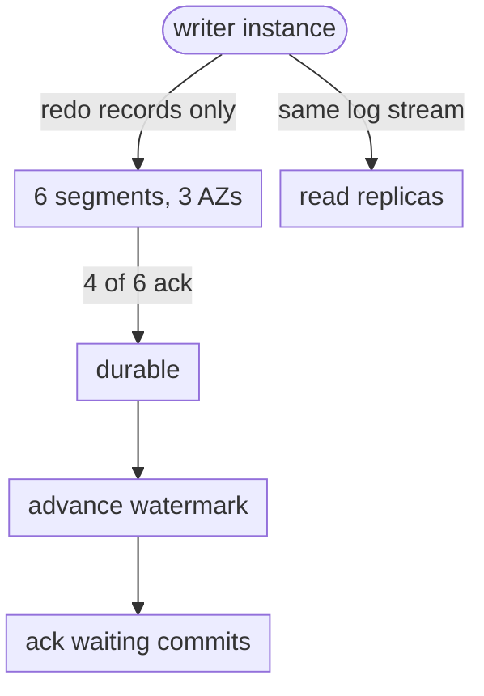
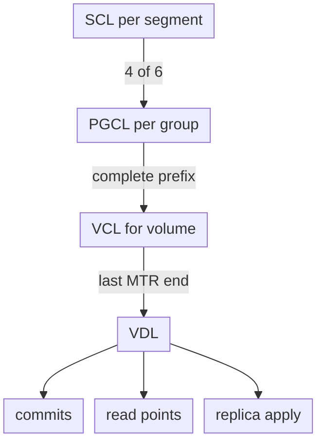
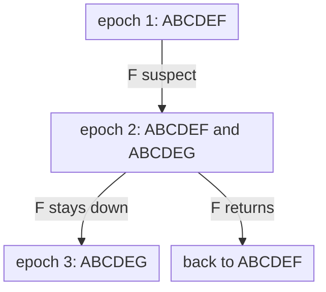

Raft commits each log entry once a majority of replicas has stored it, and Spanner runs a Paxos group per tablet, adding two-phase commit when a transaction spans groups. Amazon Aurora, the relational database AWS launched in 2015, takes a different route. It keeps one writer, moves the bottom of the storage engine onto a fleet of storage nodes, and avoids consensus on the hot path almost entirely. The design is described in two papers by Alexandre Verbitski and colleagues at AWS: [Amazon Aurora: Design Considerations for High Throughput Cloud-Native Relational Databases](https://www.amazon.science/publications/amazon-aurora-design-considerations-for-high-throughput-cloud-native-relational-databases) (SIGMOD ’17, [PDF](https://web.stanford.edu/class/cs245/readings/aurora.pdf)), cited as **[A17]**, and [Amazon Aurora: On Avoiding Distributed Consensus for I/Os, Commits, and Membership Changes](https://www.amazon.science/publications/amazon-aurora-on-avoiding-distributed-consensus-for-i-os-commits-and-membership-changes) (SIGMOD ’18, [PDF](https://pages.cs.wisc.edu/~yxy/cs764-f20/papers/aurora-sigmod-18.pdf)), cited as **[A18]**. Section numbers refer to those papers. They describe Aurora as it was in 2016–2018, so treat this as a design study, not a product manual. Paragraphs marked **My take** are my own analysis.

## The problem: the network is the new bottleneck

The authors’ starting claim is that in the cloud, “the central constraint in high throughput data processing has moved from compute and storage to the network” ([A17] abstract). Once I/O is spread across a big multi-tenant fleet, no single disk is hot. The pain is the traffic between the database and storage, made worse because a fast database writes to many storage nodes in parallel, and “the performance of the outlier storage node, disk or network path can dominate response time.”

Storage also has to outlive compute. “Instance lifetime does not correlate well with storage lifetime. Instances fail. Customers shut them down. They resize them” (§2.1). So storage becomes its own replicated tier, and its nodes fail constantly, in ways that range from a short network blip to a whole data center going dark.

## Why six copies: AZ+1

The usual answer is three copies with 2-of-3 quorums, one copy per Availability Zone (AZ). An AZ is isolated “for most faults, including power, networking, software deployments, flooding, etc.” ([A17] §2.1). The catch is that in a large fleet, some nodes are always broken. When an AZ fails, any group that already lost a copy in another AZ is down to one copy, and “will be unable to determine if the third is up to date.” [A18] puts it bluntly: AZ failures are “a correlated failure of two members in each and every quorum” (§2.1).

Aurora picks two targets: lose an entire AZ *and one more node* (“AZ+1”) without losing data, and lose an entire AZ without losing the ability to write ([A17] §1). It gets there with:

- **6 copies**, 2 in each of 3 AZs (V = 6)
- a **write quorum of 4/6** (Vw = 4)
- a **read quorum of 3/6** (Vr = 3)

These meet Gifford’s two rules: 3 + 4 > 6, so every read quorum overlaps the latest write, and 4 > 6/2, so writes can’t conflict. Lose an AZ plus one node and 3 copies remain, which is still a read quorum, and “ensuring read quorum enables us to rebuild write quorum by adding additional replica copies” (§1). Lose just an AZ and 4 remain, so writes continue.

## Segments, protection groups and a 10-second repair window

AZ+1 is only safe if a second independent failure is unlikely during the time it takes to repair the first. Rather than chase a longer mean time to failure, Aurora shrinks the mean time to repair ([A17] §2.2):

- The volume is split into **10 GB segments**. Each is copied 6 ways into a **protection group (PG)**, two per AZ. A volume is a chain of PGs, “up to 64 TB on an unreplicated basis” in 2017.
- “A 10GB segment can be repaired in 10 seconds on a 10Gbps network link.” Losing quorum takes two failures in the same 10 seconds plus an AZ failure that hits neither.
- The same repair path handles operations. To cool a hot node, mark one of its segments as bad and let the quorum migrate it. Software upgrades roll out “one AZ at a time,” never patching two members of a PG at once (§2.3).

**My take:** [Dynamo](/posts/dynamo-amazons-highly-available-key-value-store/) also settled on fixed, equal-size partitions. Aurora turns the idea into an explicit MTTR budget: name the repair time, then name what has to fail inside that window.

## The log is the database

A stock MySQL engine on top of this would drown. [A17] Figure 2 shows an active–standby MySQL across two AZs writing five kinds of data (redo log, binlog, data pages, a double-write copy of each page, and metadata files) through a chain of synchronous mirrors. The authors call it, in effect, “a 4/4 write quorum” that is “vulnerable to failures and outlier performance” (§3.1).

Aurora’s answer: “the only writes that cross the network are redo log records. No pages are ever written from the database tier, not for background writes, not for checkpointing, and not for cache eviction” (§3.2). The redo applicator moves to the storage nodes, which build pages in the background. That is optional for correctness: “the log is the database, and any pages that the storage system materializes are simply a cache of log applications.”

*Figure 1: The write path, based on §3.2 and §4.2 of [A17]. Layout is mine.*

The numbers are striking. In a 30-minute SysBench write-only run on 100 GB, Aurora completed 27,378,000 transactions against mirrored MySQL’s 780,000, at 0.95 I/Os per transaction versus 7.4 (Table 1). That is 35 times the transactions and 7.7 times fewer I/Os per transaction on the database node, “despite amplifying writes six times” (§3.1).

Crash recovery changes too. Redo is applied “continuously, asynchronously, and distributed across the fleet,” so “nothing is required at database startup” (§3.2). And unlike checkpointing, which depends on the length of the whole log, “Aurora page materialization is governed by the length of the chain for a given page.”

## Inside a storage node

Each storage node runs eight steps ([A17] §3.3, Figure 4):

1. Receive a log record and add it to an in-memory queue.
2. Persist it on disk and acknowledge.
3. Sort and group records, and find gaps where batches were lost.
4. Gossip with peer segments to fill the gaps.
5. Coalesce records into new data pages.
6. Periodically stage log and pages to S3.
7. Periodically garbage-collect old versions.
8. Periodically validate page CRCs.

Only steps 1 and 2 are on the foreground path. Background work is “negatively correlated” with foreground load, the opposite of checkpointing in a classic engine. A node that builds a backlog throttles itself, and because segments are spread “with high entropy,” the 4/6 quorum just sees a slow node. Storage nodes also “do not have a vote in determining whether to accept a write, they must do so” ([A18] §2.3). Locks, deadlocks and constraints are all settled in the database.

## Watermarks instead of consensus

The invariant that makes everything else work: the log is spread across many nodes, but “the Log Sequence Number (LSN) space is common across the database volume, monotonically increasing, and allocated by the database instance. This is the key invariant that allows Aurora to avoid distributed consensus for most operations” ([A18] §2.1).

Each log record points back to the previous record in its segment, so a segment can tell exactly where its gaps are. From that come a few watermarks:

- **SCL (Segment Complete LSN)**: the highest LSN a segment holds with no gaps below it. It is returned with every write ack ([A18] §2.3).
- **PGCL (Protection Group Complete LSN)**: advanced by the writer once SCL has moved at 4 of 6 segments.
- **VCL (Volume Complete LSN)**: the highest LSN below which every record, in every PG, has met quorum.
- **CPL (Consistency Point LSN)**: the last record of each InnoDB mini-transaction (MTR), an atomic group such as a B-tree split ([A17] §4.1).
- **VDL (Volume Durable LSN)**: “the highest CPL that is smaller than or equal to VCL.”

*Figure 2: Watermarks from §4 of [A17] and §2.3 of [A18]. Layout is mine.*

[A18] gives a small example. Odd LSNs go to PG1 and even LSNs to PG2. If 105 hasn’t reached quorum, PG1’s PGCL is 103. If 106 hasn’t, PG2’s is 104. So the VCL is 104. [A17] adds the CPL twist: if the log is complete up to 1007 but the CPLs are 900, 1000 and 1100, recovery truncates at 1000. “We are complete to 1007, but only durable to 1000.”

“No consensus is required to advance SCL, PGCL, or VCL – all that is required is bookkeeping” ([A18] §2.3). Two more rules keep the writer honest. It never hands out an LSN above VDL plus the **LSN Allocation Limit**, set to 10 million in 2017, which gives storage backpressure ([A17] §4.2.1). And it starts a network write as soon as the first record lands in a buffer, while still packing in later records until the write goes out. That gets the packet savings of batching without its waiting ([A18] §2.2).

## Commits, reads and replicas

**Commits are asynchronous.** A worker thread records the transaction’s commit LSN in a waiting list and moves on. A commit completes “if and only if, the latest VDL is greater than or equal to the transaction’s commit LSN,” and a dedicated thread sends the acks as VDL advances ([A17] §4.2.2). “There is no induced latency from group commits and no idle time for worker threads” ([A18] §2.3). (One small inconsistency: [A18] states the commit rule against VCL rather than VDL. I follow [A17].)

**Reads skip the quorum.** A page may leave the buffer cache only once its latest change is at or below VDL, so on a miss it is enough to ask for the page as of the current VDL ([A17] §4.2.3). The writer knows every segment’s SCL, so it sends the read to *one* segment that is caught up. A quorum read would have cost “a minimum of three read I/Os, and likely five,” of full blocks ([A18] §3). To cap tail latency, the writer tracks each node’s response time, usually picks the fastest, and sends a second read if one runs long ([A18] §3.1). Old versions are garbage-collected only below the lowest read point any instance still needs, called the PGMRPL.

**Replicas read the log stream.** Up to 15 read replicas mount the same storage volume. The writer sends them its log stream. A replica applies a record only if the page is already in its cache, applies only records at or below VDL, and applies each MTR atomically. Typical lag is “20 ms or less” ([A17] §4.2.4). In [A17]’s benchmark, replica lag at 10,000 writes per second was 5.38 ms for Aurora versus 300 seconds for MySQL (Table 4). Since durable state is shared, promoting a replica loses no acknowledged commit ([A18] §3.2).

## Crash recovery and epochs

The watermarks live only in the writer’s memory. [A18] calls this “a trade worth making since commits are many orders of magnitude more common than crashes” (§2.4). On restart, the writer:

1. Reads from a **read quorum** of each PG, which “is sufficient to guarantee discovery of any data that could have reached a write quorum,” and recomputes the watermarks ([A17] §4.3).
2. Writes a **truncation range** that cancels everything above the new VDL ([A17] §4.3). The 10-million LSN limit tells it how high that range must go. The range is versioned with an epoch, so an interrupted recovery can safely restart. ([A18] §2.4 cuts at the newly computed VCL instead, the same split as the commit rule. I follow [A17].)
3. Bumps the **volume epoch** in a write quorum of every PG. Storage rejects requests with an old epoch, which fences out a zombie writer. “Aurora, rather than waiting for a lease to expire, just changes the locks on the door” ([A18] §2.4).
4. Opens the database. Undo for in-flight transactions runs in the background. Recovery is “generally under 10 seconds,” even after crashing while handling more than 100,000 write statements per second ([A17] §4.3).

## Membership changes you can undo

With 6 segments per 10 GB, “a 64TB volume has 38,400 segments” ([A18] §4), so replacing failed members is routine. Traditional membership changes stall I/O and can’t re-admit a member they have fenced out. Aurora uses **quorum sets** and a **membership epoch** instead.

Say segment F looks unhealthy. Aurora doesn’t jump from ABCDEF to ABCDEG. It first moves to a state where writes need 4/6 of ABCDEF *and* 4/6 of ABCDEG, and reads need 3/6 of either. If F comes back, it returns to ABCDEF. If not, once G has caught up, it moves to ABCDEG. Each step is one epoch write to a write quorum, and reads and writes never stop. Even if E fails mid-change, “simply writing to the four members ABCD meets quorum” ([A18] §4.1).

*Figure 3: A two-step membership change, based on §4.1 and Figure 5 of [A18]. Layout is mine.*

The same idea cuts cost. Each PG has three **full** segments (redo plus pages) and three **tail** segments (redo only). Writes need 4/6 of any segment *or* 3/3 of the full ones. Reads need 3/6 of any *and* 1/3 of the full ones. Storage cost ends up “closer to three copies of the data rather than a full six” ([A18] §4.2). A volume geometry epoch can even change the quorum model, for example to 3/4 during an extended AZ outage.

## What the team learned from customers

[A17] §7 is a list of things customers did that the team didn’t expect:

- **Schema-per-tenant SaaS.** Some customers had “more than 50,000 customers of their own,” and “over 150,000 tables” on small instances was common. That put pressure on metadata structures like the dictionary cache.
- **Spikes.** One customer appeared on a nationally televised show without stressing the database. Several ran “over 8000 connections per second.”
- **Constant schema changes.** DBAs reported “a few dozen migrations a week.” Aurora added online DDL that versions schemas per page, decodes each page on demand using its schema history, and lazily upgrades a page to the latest schema when it is next modified.
- **No tolerance for patch downtime**, even “30 seconds every 6 weeks or so.” Zero-Downtime Patching waits for a moment with no active transactions, saves session state, swaps the engine, and restores the sessions.

[A18] closes with the line that sums up the whole design: “Most distributed consensus algorithms abhor state and establish their baseline from first principles. But, databases are all about the management of state. Why not use it for our own benefit?”

## How it compares

- **Dynamo** used R + W > N on every request, with sloppy quorums. Aurora uses a strict 4/6 write quorum but almost never reads from a quorum, because the single writer knows who is up to date.
- **Raft** puts every entry through a majority vote and elects its own leader. Aurora picks the writer in its control plane and fences old writers with epochs instead of terms.
- **Spanner** runs Paxos per tablet, 2PC across groups and commit wait. Aurora avoids all of that by having one writer per volume in one region.

**My take:** Aurora doesn’t eliminate consensus. It moves the one decision that needs it, *who is the writer*, out of the data path, and makes every data-path decision a local comparison of monotonic numbers.

## Patterns worth stealing

- **Ship intent, not state.** Send redo deltas and let the receiver build pages.
- **Size quorums for correlated failure**: the biggest blast radius plus background noise.
- **Shrink MTTR.** Small segments make repair fast and reuse the same path for maintenance.
- **Use monotonic watermarks instead of agreement** when one party owns the sequence.
- **Park the work, not the thread.** Queue commits behind a watermark.
- **Fence with epochs, not leases.**
- **Make reconfiguration reversible** with overlapping quorum sets.

## A design question for you

Design the storage layer for a managed, PostgreSQL-compatible database in one region with three AZs. Each database has one writer and up to 10 read replicas, and volumes grow from 10 GB to 50 TB. No acknowledged commit may be lost even if a whole AZ and one more storage node fail. Writes must keep working with one AZ down. p99 commit latency must stay close to one cross-AZ round trip even while 1% of storage nodes are slow. Replicas must lag by under 50 ms, failover must take under 30 seconds with no data loss, and stored bytes must stay under 3.5 times the logical data.

What is your replication factor, quorum and unit of placement? What does the writer send on an UPDATE? How does it know a commit is durable, and how do you serve a cache miss without a quorum read? How do you stop an old writer after a crash, and replace a flaky node without pausing I/O?

Which of Aurora’s choices would you keep, and which would you change?

## Sources

Primary sources:

- Alexandre Verbitski et al., [Amazon Aurora: Design Considerations for High Throughput Cloud-Native Relational Databases](https://www.amazon.science/publications/amazon-aurora-design-considerations-for-high-throughput-cloud-native-relational-databases), SIGMOD ’17. [PDF](https://web.stanford.edu/class/cs245/readings/aurora.pdf), DOI [10.1145/3035918.3056101](https://doi.org/10.1145/3035918.3056101).
- Alexandre Verbitski et al., [Amazon Aurora: On Avoiding Distributed Consensus for I/Os, Commits, and Membership Changes](https://www.amazon.science/publications/amazon-aurora-on-avoiding-distributed-consensus-for-i-os-commits-and-membership-changes), SIGMOD ’18. [PDF](https://pages.cs.wisc.edu/~yxy/cs764-f20/papers/aurora-sigmod-18.pdf), DOI [10.1145/3183713.3196937](https://doi.org/10.1145/3183713.3196937).

Further reading:

- [Amazon Aurora storage](https://docs.aws.amazon.com/AmazonRDS/latest/AuroraUserGuide/Aurora.Overview.StorageReliability.html), AWS documentation for today’s service.
- Werner Vogels, [Amazon Aurora ascendant: How we designed a cloud-native relational database](https://www.allthingsdistributed.com/2019/03/amazon-aurora-design-cloud-native-relational-database.html), 2019.
- For the comparisons: Diego Ongaro and John Ousterhout, [In Search of an Understandable Consensus Algorithm](https://raft.github.io/raft.pdf); James C. Corbett et al., [Spanner](https://static.googleusercontent.com/media/research.google.com/en//archive/spanner-osdi2012.pdf); and Giuseppe DeCandia et al., [Dynamo](https://www.allthingsdistributed.com/files/amazon-dynamo-sosp2007.pdf).
