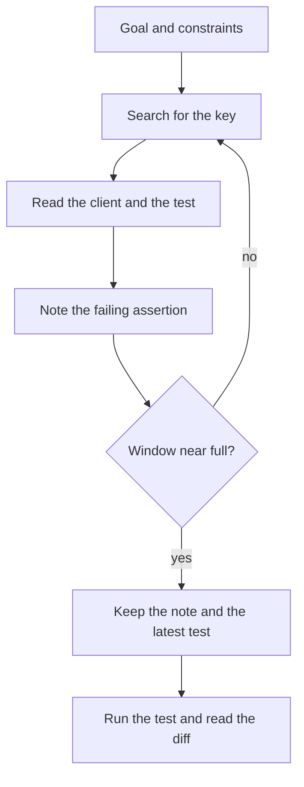

A coding agent is a model that calls tools in a loop: search the repository, open a file, run a test, edit. Cursor and Kiro are two products that do this. Each call sees only the tokens still in the window. Choosing those tokens is the job.

Two sources carry the claims below, and they are different kinds of documents. [Effective context engineering for AI agents][Anthropic 2025] is an engineering article by Prithvi Rajasekaran, Ethan Dixon, Carly Ryan, and Jeremy Hadfield, published 29 September 2025. It is not a white paper and not a peer-reviewed paper. [A Survey of Context Engineering for Large Language Models][Mei et al. 2025] is an arXiv preprint by Lingrui Mei and 14 other authors, version 2, 21 July 2025. The arXiv record says "ongoing work" and lists no journal. I use the article for practices Anthropic reports, and the preprint for a taxonomy. Neither source is a benchmark I ran.

## Prompt engineering and context engineering

Prompt engineering is how you write and organize instructions, especially the system prompt, so a call does the task [Anthropic 2025]. That covered most of the work when a call was one-shot classification or generation.

Context engineering is how you curate every token on later calls. The prompt is one part. Tool definitions, tool results, retrieved files, and message history are the rest [Anthropic 2025]. An agent loop creates that extra text. Each search result is a candidate for the next turn, and something has to accept or reject it.

[Mei et al. 2025] write the same split as a definition. A prompt is one string. Context is an assembly of instructions, retrieved knowledge, tool definitions, memory, state, and the current request, concatenated under the model's length limit. Their objective is to choose that assembly so the output scores well on the task.

**My take:** use the list as a checklist before the next tool call. Anthropic's rule is the smallest set of high-signal tokens that still makes the desired behavior likely [Anthropic 2025]. Every token that remains should have a reason to be there.

As the window grows, recall of what is already in it gets worse. [Anthropic 2025] calls that context rot and attributes it to needle-in-a-haystack style tests. The article names no study and gives no figure, so this post has neither. Separately, they point at transformer attention: n² pairwise relationships for n tokens, so the budget thins as the window grows.

## Goals, constraints, and the files you allow

The request is one component of that assembly [Mei et al. 2025]. Write it as an outcome and constraints: what behavior must change, which files stay untouched, and which command must pass.

[Anthropic 2025] describes the altitude that works. One failure mode hardcodes a branch for every case. The other assumes shared context the model does not have ("clean up the payment client"). State the invariant and leave the edit open.

The block below is an illustration. I did not run an agent on it.

```text
Goal: a repeated CreateCharge with the same Idempotency-Key returns the stored response and does not call the processor again.
Constraints: do not change the public request type. Only edit files under payments/. payments/charge_retry_test.go must pass.
```

That invariant is how payment APIs keep a retry from charging twice. The server-side contract is in [Idempotency keys: how payment APIs make retries safe](/posts/idempotency-keys-safe-retries/).

The repository does not fit in the window, and most of it is irrelevant to this charge. [Anthropic 2025] describes Claude Code's just-in-time pattern: keep paths and queries, and load bytes with a tool when the next step needs them. `CLAUDE.md` goes in at the start. Glob and grep fetch files later. They present that hybrid as a way past a stale index of the whole tree.

The same shape fits a coding agent such as Cursor or Kiro. It is a way to fill the window, not a setting in either product. Put a short standing note up front (how tests run, which directory owns payments), then search and open `payments/client.go` and the retry test. Known paths can be passed directly. Leave the module listing, the lockfile, and the neighboring service out.

A path is signal before you read the file. Anthropic's example is `test_utils.py` under `tests/` versus the same filename under `src/core_logic/` [Anthropic 2025]. The directory says which one is production code.

## Tools, results, and retrieval

Tools are how the agent reaches the repo and the tests. [Anthropic 2025] wants unambiguous parameters, tools that do not overlap, and a choice a human could explain. Return the assertion and a few frames. [Mei et al. 2025] describe the loop as tool-integrated reasoning: pick a tool, fill the arguments, run it, and read the result back into the window.

The schema below illustrates the contract. It is not the API of Cursor, Kiro, or Claude Code.

```json
{
  "name": "read_file",
  "description": "Read one file. Return only the requested line range.",
  "parameters": {
    "path": "Repository path, such as payments/client.go",
    "start_line": "First line",
    "end_line": "Last line"
  }
}
```

Retrieval chooses which bytes come back. [Mei et al. 2025] covers search for external knowledge and retrieval-augmented generation, the case where that text is placed in the window. Search for `CreateCharge` or `Idempotency-Key`, then read the matching function. A whole-tree index is yesterday's tree. Reading the file now avoids that [Anthropic 2025].

A tool that creates a charge or writes a row has a side effect. If the result never came back, a second call repeats the effect. Put the stored response for that idempotency key back in the window.

## Notes, compaction, and what counts as done

A long edit-and-test loop exceeds the window. [Anthropic 2025] argues that a larger window still fills with low-value tokens, so the curated subset still matters. Two techniques follow.

Compaction summarizes the conversation and starts a fresh window with that summary. Anthropic's Claude Code account keeps decisions, open bugs, and implementation details, and drops redundant tool output. Clearing a tool result once it has been used is the light version. The risk is a summary that drops a fact whose importance shows up later. I have not tuned a compaction prompt, and this post has no recall number.

Notes are the other lever. The agent writes a todo or a `NOTES.md` outside the window and reads it back after a reset [Anthropic 2025]. The survey puts memory hierarchies and compression under context management because the window is finite [Mei et al. 2025].

The note for this task holds the invariant (same key, same body, no second processor call), the file and the failing assertion, and the decision still open. File bodies can be reread. Logs from tests that already passed can go.

[Mei et al. 2025] separate component checks from whole-system checks. On the pieces: search should open the payment client rather than a stale copy, `read_file` should get a real path and a line range, and the note should still hold the constraint after compaction. On the task: run `payments/charge_retry_test.go` and read the diff. The public type is unchanged, and a second call does not reach the processor. The agent's recap is more window text. The test and the diff are the evidence.

## Three failures

**Stale context.** The window holds a file from before a rename, or a hit from an index built before the merge. Open the path again before editing [Anthropic 2025].

**Irrelevant dumps.** A pasted tree, a long log, or every tool schema you own spends the attention budget described above [Anthropic 2025]. Delete those tokens before you summarize. A summary of a dump is a shorter dump.

**Untrusted retrieved instructions.** A file, a ticket, or a page can tell the model to ignore the task, print the environment, or edit another directory. That sentence arrived as retrieved data. Section 7.4.2 of the survey lists prompt injection among the open security problems and does not provide a filter [Mei et al. 2025]. The goal stays in the instructions you wrote. A comment in a retrieved file does not replace it, and it does not get a write outside `payments/`.

## One pass, as a sketch

This diagram is the charge-retry task drawn as context decisions. It is not a session I ran.



*Figure 1: What stays in the window for the charge-retry task. The layout is mine. Neither source draws it.*

Paste the goal and constraints with no files attached. Search for `Idempotency-Key` and `CreateCharge`, open the `payments/` hit and the retry test, and leave other hits as paths. Run that test, keep the failing assertion in the note, and drop the log. Edits stay under `payments/`. When the window is mostly old reads, compact to the note, the constraint, and the latest test output. Stop when the test passes, the diff stays in `payments/`, the public type is unchanged, and a repeated key does not call the processor. A deleted path from an old index, a paste of every file that mentions "key," or a comment that says to commit `.env` are the three failures above. None of those becomes a tool call.

## References

Engineering article:

- Prithvi Rajasekaran, Ethan Dixon, Carly Ryan, and Jeremy Hadfield, [Effective context engineering for AI agents][Anthropic 2025], Anthropic, 29 September 2025. Engineering article by the Applied AI team. `/engineering/effective-context-engineering-for-ai-agents` currently redirects to this URL. Not a white paper and not a peer-reviewed paper.

Preprint:

- Lingrui Mei, Jiayu Yao, Yuyao Ge, Yiwei Wang, Baolong Bi, Yujun Cai, Jiazhi Liu, Mingyu Li, Zhong-Zhi Li, Duzhen Zhang, Chenlin Zhou, Jiayi Mao, Tianze Xia, Jiafeng Guo, and Shenghua Liu, [A Survey of Context Engineering for Large Language Models][Mei et al. 2025], arXiv:2507.13334v2 [cs.CL], 21 July 2025. Preprint, first submitted 17 July 2025. Comments field: "ongoing work." The abs page lists no journal reference. [10.48550/arXiv.2507.13334](https://doi.org/10.48550/arXiv.2507.13334) is the arXiv-issued DOI.

[Anthropic 2025]: https://www.anthropic.com/research/effective-context-engineering-for-ai-agents
[Mei et al. 2025]: https://arxiv.org/abs/2507.13334
