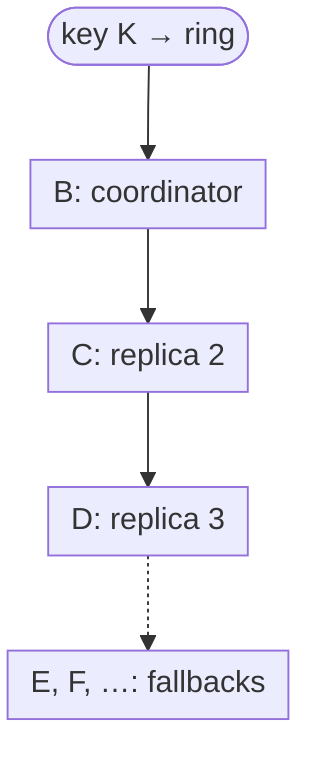
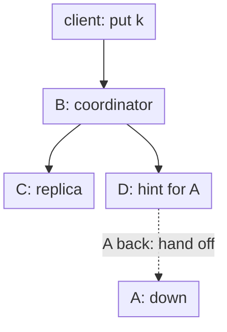
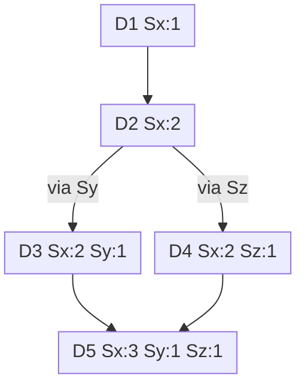

Amazon’s shopping cart had one hard rule: an “Add to Cart” operation “can never be forgotten or rejected.” In 2007, Giuseppe DeCandia and colleagues described the store built around that rule: [Dynamo: Amazon’s Highly Available Key-value Store](https://www.allthingsdistributed.com/files/amazon-dynamo-sosp2007.pdf), SOSP ’07. I’ll cite it as **[DeCandia 2007]**, with section numbers. Every Amazon-specific number and mechanism here comes from it and describes Amazon around 2006–2007. Paragraphs marked **My take** are my own analysis.

One clarification first. **Dynamo is not DynamoDB.** Dynamo was an internal system, which Werner Vogels said at the time was “not directly exposed externally as a web service” ([Vogels 2007](https://www.allthingsdistributed.com/2007/10/amazons_dynamo.html)). DynamoDB launched in January 2012 ([Vogels 2017](https://www.allthingsdistributed.com/2017/10/a-decade-of-dynamo.html)) and is a different design. Its [USENIX ATC ’22 paper](https://www.usenix.org/conference/atc22/presentation/elhemali) describes Multi-Paxos replication groups whose leader serves writes and strongly consistent reads. Everything below is the 2007 system.

## The problem: a cart that never says no

Amazon ran “a highly decentralized, loosely coupled, service oriented architecture consisting of hundreds of services” (§1). Many of them only needed to read and write values by primary key. For them, “the common pattern of using a relational database would lead to inefficiencies and limit scale and availability.” Dynamo’s requirements (§2.1–§2.3):

- **Simple key-value interface.** Values are opaque blobs, “usually less than 1 MB.” There are no multi-key operations.
- **Weak consistency, no isolation.** Dynamo “does not provide any isolation guarantees and permits only single key updates.”
- **A trusted network.** The environment is “assumed to be non-hostile,” so there is no authentication or authorization inside the store.
- **Tail-latency SLAs.** A typical example: respond within **300 ms for 99.9%** of requests at a peak of **500 requests per second** (§2.2). Amazon set SLAs at the 99.9th percentile because an SLA “stated in terms of mean or median response times” misses customers at the high end of the distribution, such as those with long histories that need more personalization work.
- **Always writeable.** Many stores resolve conflicts on writes and reject a write when they cannot reach enough replicas. Dynamo moved conflict resolution “to the reads in order to ensure that writes are never rejected” (§2.3).

At the time, the cart service handled “tens of millions requests” [sic] that led to “well over 3 million checkouts in a single day,” and the session service handled “hundreds of thousands of concurrently active sessions” (§1).

## Partitioning: a ring with virtual nodes

Dynamo hashes each key with **MD5** into a **128-bit** identifier and places it on a ring (§4.1–§4.2). To find a key’s owner, you walk clockwise from the key’s position. The first node you reach is the key’s **coordinator**. The coordinator stores the key and replicates it to the next **N − 1** distinct nodes clockwise. So each node stores the keys between itself and its Nth predecessor. With N = 3, node D stores the ranges (A, B], (B, C], and (C, D] (§4.3, Figure 2).

Plain consistent hashing gives uneven load and ignores differences between machines. So each physical host owns many positions on the ring, called **virtual nodes** or **tokens**. Bigger hosts get more tokens. When a host fails, its load spreads across many peers instead of landing on one neighbor (§4.2).

The list of nodes responsible for a key is its **preference list**. It holds more than N nodes so that it can absorb failures, and it is built by skipping ring positions so that it contains only **distinct physical nodes** (§4.3). It is also constructed so that its nodes are spread across multiple data centers (§4.6).

*Figure 1: Walking the ring clockwise from key K, based on Figure 2 and §4.3 of [DeCandia 2007]. Tokens on the same physical host are skipped. Layout is mine.*

## Reads and writes: N, R, and W

Requests reach a node either through a generic load balancer or through a partition-aware client library that routes straight to a coordinator. A node that is not in the top N of the key’s preference list forwards the request to the first of those N (§4.5). Each Dynamo instance is configured with three knobs:

- **N:** how many replicas store each key.
- **W:** how many nodes must acknowledge a write. The coordinator writes locally, sends the write to the N highest-ranked reachable nodes, and succeeds after **W − 1** of them respond.
- **R:** how many nodes must answer a read. If the read finds conflicting versions, it returns all of them.

The paper notes that setting **R + W > N** “yields a quorum-like system,” and that latency “is dictated by the slowest of the R (or W) replicas” (§4.5). Teams tuned these knobs per service (§6):

| Pattern (§6) | Setting | Used for |
|---|---|---|
| Business-logic reconciliation | app merges siblings | shopping cart |
| Timestamp-based reconciliation | last write wins | session information |
| High-performance read engine | **R = 1, W = N** | product catalog, promotional items |

*Table 1: Configurations named in §6 of [DeCandia 2007].*

The common (N, R, W) configuration, used by several instances, was **(3, 2, 2)** (§6).

## Sloppy quorum and hinted handoff

A strict quorum blocks a write when enough of the key’s home nodes are down. Dynamo instead uses a **sloppy quorum**: “all read and write operations are performed on the first N **healthy** nodes from the preference list” (§4.6, emphasis mine).

Here is the paper’s example. With N = 3, suppose node A is down during a write. The replica that belongs on A goes to node D instead, with a **hint** in its metadata naming A as the intended owner. D keeps hinted replicas in a separate local database and scans it periodically. Once A recovers, D sends the replica to A and may then delete its copy (§4.6). Because preference lists span data centers, Dynamo can “handle entire data center failures without a data outage.”

*Figure 2: Hinted handoff, from the example in §4.6 of [DeCandia 2007]. B, the first healthy node, coordinates and stores the write locally. The write succeeds once W nodes, counting B, have it. Layout is mine.*

**My take:** R + W > N is **not** a strict overlap guarantee here. If the write went to D, B, and C while A was down, a later read from the original A, B, C set can miss it until the hint is handed off. The paper is honest about this: it calls the system “quorum-like.” When you hear “Dynamo-style quorums,” remember that the word “sloppy” changes the math.

## Versioning: vector clocks and siblings

Dynamo is eventually consistent. A `put` can return before every replica has the update, so different replicas can hold different versions (§4.4). Every version carries a **vector clock**, “a list of (node, counter) pairs.” If every counter in clock X is less than or equal to the matching counter in clock Y, then X is an ancestor of Y “and can be forgotten.” Otherwise the two versions conflict.

The client passes the **context** from an earlier read into its next write. Here is the paper’s example (§4.4, Figure 3):

*Figure 3: Clocks exactly as in Figure 3 / §4.4 of [DeCandia 2007]. D3 and D4 are concurrent, so a read returns both. The client merges them and Sx coordinates the write of D5. Layout is mine.*

When the system can tell that one version descends from another, it reconciles **syntactically** and drops the older one. When it cannot, the application reconciles **semantically**. The cart merges the siblings, so “an ‘add to cart’ operation is never lost. However, deleted items can resurface” (§4.4).

Clocks could grow forever, so Dynamo stores a timestamp with each (node, counter) pair. When a clock reaches a threshold (“say 10”) pairs, it drops the oldest one. The paper admits this “can lead to inefficiencies in reconciliation” because descendant relationships can no longer be derived accurately, but says the problem had not surfaced in production (§4.4).

**My take:** the paper doesn’t say truncation is safe, only that descendant relationships “cannot be derived accurately” once pairs are dropped. My reading of the §4.4 rules is that this can fail in both directions. An ancestor can look concurrent, which gives the application spurious siblings to merge. Or a concurrent version can look like an ancestor and be discarded as one that “can be forgotten,” losing its update. For example, X = {Sa:5, Sb:2} and Y = {Sa:3, Sb:2, Sc:1} are concurrent, but if X drops its Sa pair it becomes {Sb:2}, which is ≤ Y. The paper says only that the problem “has not surfaced in production.” For a cart, spurious siblings are one more way a deleted item can reappear.

How often did divergence happen? Over 24 hours of cart traffic, “99.94% of requests saw exactly one version; 0.00057% of requests saw 2 versions; 0.00047% of requests saw 3 versions and 0.00009% of requests saw 4 versions” (§6.3). As printed, those figures don’t add up to 100%, so read them only as “rare.” The paper adds that divergence came mostly from concurrent writers, “usually triggered by busy robots (automated client programs) and rarely by humans,” not from failures.

## Repair and membership

**Read repair.** After a read, the coordinator waits a little for late responses. Any replica that returned a stale version gets the latest one. This “relieves the anti-entropy protocol from having to do it” (§5).

**Merkle-tree anti-entropy.** For longer outages, every node keeps one **Merkle tree** per key range it hosts. Leaves are hashes of individual keys’ values. Each parent is the hash of its children. Two replicas compare roots. If the roots match, the range is in sync. If not, they walk down only the branches whose hashes differ until they find the keys that are “out of sync.” That minimizes the data transferred and the disk reads (§4.7). The cost: when nodes join or leave, key ranges change and the trees must be recalculated (§6.2).

**Gossip and explicit membership.** An outage “rarely signifies a permanent departure,” so adding and removing nodes is **explicit**. An administrator uses a command-line tool or browser to connect to a node and issue the change (§4.8.1). Every second, each node contacts a random peer, and the two reconcile their membership histories. Some nodes act as **seeds** that all nodes know about. Seeds prevent a logically partitioned ring, for example two nodes added separately that don’t know about each other (§4.8.2). Failure detection is purely **local**: if B doesn’t answer A, then A treats B as failed, routes around it, and periodically retries (§4.8.3).

**Joining.** When node X joins between A and B with N = 3, X takes over (F, G], (G, A], and (A, X]. B, C, and D each hand off the range they no longer need (§4.9).

## Implementation: tuned for the 99.9th percentile

Each node has three parts: request coordination, membership and failure detection, and a pluggable local store. Supported stores included Berkeley DB Transactional Data Store, BDB Java Edition, MySQL, and an in-memory buffer with a persistent backing store. Most production instances used BDB Transactional Data Store. The code is Java, the coordinator uses SEDA-style staged state machines, and all communication uses Java NIO channels (§5).

A few choices stand out:

- **Fastest replier coordinates the write.** A write usually follows a read, so the write coordinator is “the node that replied fastest to the previous read operation” (§5). That increases “the chances of getting ‘read-your-writes’ consistency.”
- **A write buffer, with one durable copy.** Writes go to an in-memory buffer that a writer thread flushes periodically. In Dec 2006, 99.9th-percentile latencies were about 200 ms, an order of magnitude above the averages. Buffering just 1,000 objects cut the peak 99.9th-percentile latency “by a factor of 5.” To reduce the durability risk, the coordinator picks one of the N replicas for a “durable write.” It still waits for only W responses, so that one slow durable write does not delay the request (§6.1).
- **Client-driven coordination.** Partition-aware clients pull membership from a random node every 10 seconds and route straight to the coordinator. Compared with server-driven coordination, client-driven cut 99.9th-percentile read latency from 68.9 ms to 30.4 ms and write latency from 68.5 ms to 30.4 ms (Table 2, §6.4). The cost is up to 10 seconds of stale membership.
- **Admission control for background work.** Anti-entropy and handoff run alongside customer traffic. A controller watches foreground signals, such as the 99th-percentile database read latency over a 60-second window against a 50 ms target, and shrinks background tasks’ time slices when the foreground suffers (§6.5).

## What broke: three partitioning strategies

The paper’s most practical section is about rebalancing (§6.2). Dynamo went through three schemes:

| Strategy | Tokens and partitions | What happened |
|---|---|---|
| 1 | T random tokens per node; partition by token value | Bootstrapping a new node meant scanning peers’ stores at low priority. In busy season it took “almost a day.” Merkle trees needed recalculation on every membership change, and archiving the key space was painful. |
| 2 | T random tokens per node; Q equal-sized partitions | Worst load-balancing efficiency. Used only briefly, during the migration. |
| 3 | Q/S tokens per node; Q equal-sized partitions | Best efficiency. Membership info about **three orders of magnitude** smaller than strategy 1. Partitions live in separate files, so they move and archive as units. |

*Table 2: Summarized from §6.2 of [DeCandia 2007]. T is the number of tokens per node in strategies 1 and 2, Q the number of partitions, and S the number of nodes.*

Strategy 3’s cost is that changing membership “requires coordination” to keep the assignment properties.

**My take:** this is the lesson I’d keep if I forgot everything else. **Separate data placement from data partitioning.** Random tokens made both placement and partition boundaries move together. Fixed, equal-sized partitions turn rebalancing into moving files. Many later systems ship with a fixed number of equal-sized partitions, many more than there are nodes.

## What Dynamo gave up

Dynamo was a good fit for its job because it refused other jobs:

- **No isolation and no multi-key operations.** Only single-key updates (§2.1).
- **No strong consistency.** Applications had to handle siblings, or accept last-write-wins.
- **A limit on scale.** Every node gossiped the full routing table. The paper says this worked for a “couple of hundreds of nodes,” but scaling to “tens of thousands of nodes is not trivial” (§6.6).
- **No security inside the cluster.** That was fine because the environment was non-hostile (§2.1).

In return, the paper reports that Dynamo provided “successful responses (without timing out) for 99.9995% of its requests and no data loss event has occurred to date” (§6.6).

**My take:** compare this with Facebook’s TAO and memcache. Those systems keep **one writer per shard** (a master database region and a leader cache tier) and make reads cheap and slightly stale. Dynamo keeps **many writers per key** and pushes the cost into reads and the application’s merge logic. If you can’t write a merge function for your data, you probably want a single writer.

## Patterns worth stealing

- **Design for the 99.9th percentile.** Averages hide the customers who suffer most.
- **Fix the partition count up front.** Move whole partitions, not key ranges.
- **Hint, don’t block.** Accept writes on a stand-in node and hand them off later.
- **Make conflicts explicit.** Return siblings and let the domain merge them, and record deletes explicitly if they matter.
- **Repair at three speeds.** Read repair right away, hinted handoff for short outages, and Merkle anti-entropy for everything else.
- **Throttle background work against foreground latency.**

## A design question for you

Design a highly available shopping-cart and session store that spans three regions. A customer must always be able to add to or remove from their cart, even if one region is unreachable or a few nodes in each region are down. Sessions are read on every page and updated often. Carts are small (a few KB). Your tail-latency target is a 99.9th-percentile budget of a few hundred milliseconds per request, with most requests served in-region.

How do you partition and place data, and what is your unit of rebalancing? What N, R, and W would you pick for carts versus sessions, and what does each cost during a regional partition? How do you resolve conflicting carts, and stop a removed item from coming back? How do nodes tell “down” from “gone,” and how do replicas reconverge after a 10-minute outage versus a permanent one?

How would you answer, and which of Dynamo’s 2007 choices would you change today?

## Sources

Primary source:

- Giuseppe DeCandia, Deniz Hastorun, Madan Jampani, Gunavardhan Kakulapati, Avinash Lakshman, Alex Pilchin, Swaminathan Sivasubramanian, Peter Vosshall, Werner Vogels, [Dynamo: Amazon’s Highly Available Key-value Store](https://www.allthingsdistributed.com/files/amazon-dynamo-sosp2007.pdf), SOSP ’07.

Further reading:

- Werner Vogels, [Amazon’s Dynamo](https://www.allthingsdistributed.com/2007/10/amazons_dynamo.html), All Things Distributed, October 2007 — context for the paper.
- Werner Vogels, [A Decade of Dynamo](https://www.allthingsdistributed.com/2017/10/a-decade-of-dynamo.html), All Things Distributed, October 2017 — how Dynamo led to DynamoDB.
- Mostafa Elhemali et al., [Amazon DynamoDB: A Scalable, Predictably Performant, and Fully Managed NoSQL Database Service](https://www.usenix.org/conference/atc22/presentation/elhemali), USENIX ATC ’22 — the very different design of today’s DynamoDB.
