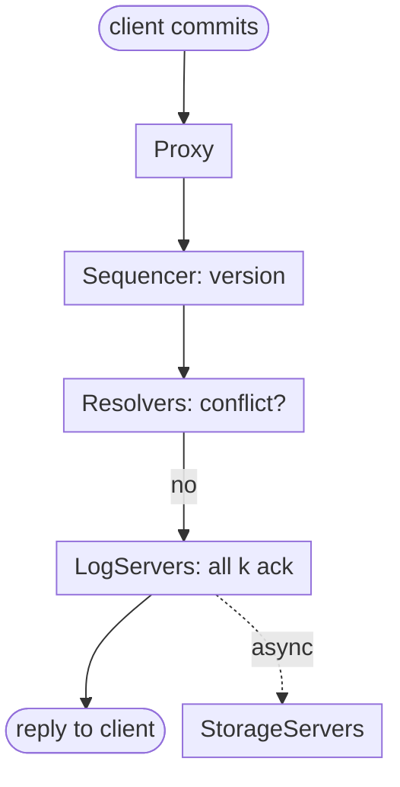
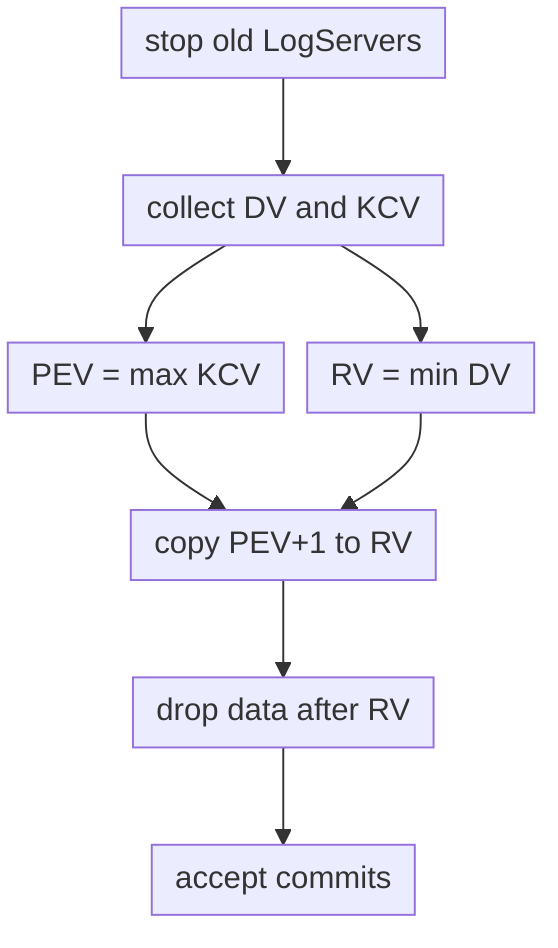
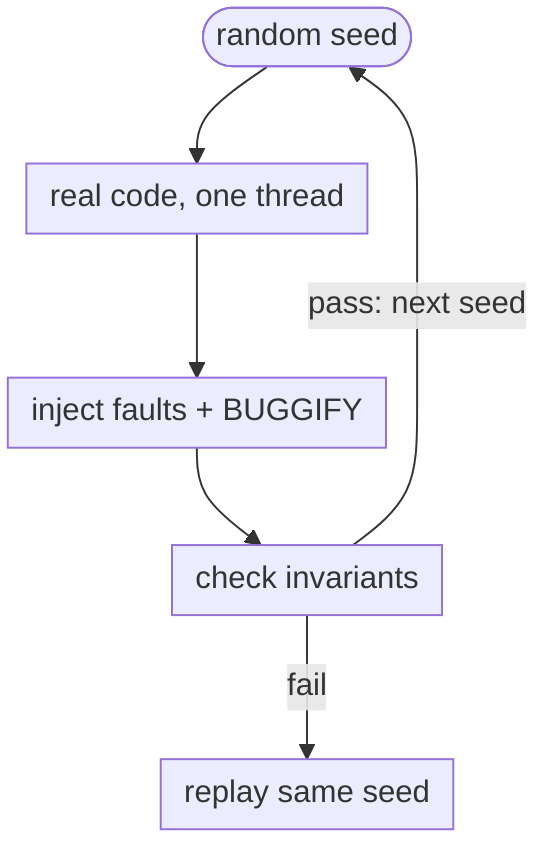

[Raft](https://mimi146.github.io/blog/posts/raft-understandable-consensus/) masks failures with majorities. [Spanner](https://mimi146.github.io/blog/posts/spanner-truetime-external-consistency/) orders transactions with locks and TrueTime. [Aurora](https://mimi146.github.io/blog/posts/amazon-aurora-the-log-is-the-database/) keeps one writer and pushes redo into a quorum-replicated storage fleet. FoundationDB, the transactional key-value store behind Apple’s CloudKit, does something else on each count. It splits the database into a dozen narrow roles. It orders every commit with a single Sequencer and checks conflicts without locks. It keeps only f+1 copies of the log. Whenever anything in the write path fails, it tears the write path down and rebuilds it in a few seconds.

The design is described in [FoundationDB: A Distributed Unbundled Transactional Key Value Store](https://www.foundationdb.org/files/fdb-paper.pdf) by Jingyu Zhou and colleagues (SIGMOD ’21, DOI [10.1145/3448016.3457559](https://doi.org/10.1145/3448016.3457559)), cited here as **[FDB]**. Section numbers refer to it. A few details come from the official [FoundationDB docs](https://apple.github.io/foundationdb/architecture.html), marked **[docs]**. The paper describes FDB around 2020, so treat this as a design study, not a product manual. Paragraphs marked **My take** are my own analysis.

## The problem: ACID at NoSQL scale

NoSQL systems scaled by “sacrific[ing] transactional semantics,” which forced developers “to reason about interleavings of updates from concurrent operations” ([FDB] §1). FoundationDB was started in 2009 to avoid that trade. It is an ordered key-value store with **strictly serializable** transactions across the whole keyspace. It became open source under the Apache license in 2018 (§6).

It also deliberately builds only the “lower half” of a database. There’s no query language, schema, data model or secondary index. Those come from stateless **layers** on top, such as the FoundationDB Record Layer, a JanusGraph backend and a CouchDB rebuild (§1). The API is `get`, `set`, `getRange`, `clear` and `commit`. Writes are buffered in the client until commit (§2.2).

The limits matter for everything that follows. Keys can be up to 10 KB, values up to 100 KB, and a transaction up to 10 MB (§2.2). A transaction also can’t run longer than 5 seconds (§6.4). The target is OLTP workloads that are “read-mostly, read and write a small set of keys, have low contention, and require scalability” (§2.3.2).

## Control plane and data plane

The **control plane** is small. Coordinators run Active Disk Paxos and store the transaction system’s configuration. They elect a singleton **ClusterController**, which monitors servers and recruits the **Sequencer**, the **DataDistributor** (shard placement and failure handling) and **Ratekeeper** (overload protection) (§2.3.1).

The **data plane** has three parts (§2.3.2):

- A **transaction system** of stateless processes. The **Sequencer** hands out read and commit versions. **Proxies** serve read versions and run commits. **Resolvers** detect conflicts, each for its own slice of the keyspace.
- **LogServers**: replicated, sharded write-ahead-log queues.
- **StorageServers**: shards of contiguous key ranges that serve reads. Together they “form a distributed B-tree,” built on a modified SQLite.

Clients read directly from StorageServers, so read capacity scales with StorageServers. Commit capacity scales with Proxies, Resolvers and LogServers. That is also why MVCC data lives in storage, not in the transaction system (§2.3.3).

The system has no external dependencies. System metadata lives under keys with the `0xFF` prefix on StorageServers. The list of StorageServers is in the LogServers, and the log configuration is on the Coordinators (§2.3.4). If any Proxy, Resolver or LogServer fails, the Sequencer *terminates itself*. The ClusterController recruits a new one, which builds a new transaction system. Each such generation is an **epoch** (§2.3.5).

## The commit path

A transaction begins by asking a Proxy for a **read version**: one no smaller than any commit version already issued. Reads then go straight to StorageServers at that version. Commit has three steps (§2.4.1):

1. The Proxy gets a **commit version** from the Sequencer. It is larger than every read or commit version issued so far, and versions advance at “one million versions per second.”
2. The Proxy sends the read and write sets to the **Resolvers**. If any Resolver finds a conflict, the transaction aborts.
3. The Proxy writes the transaction to its **LogServers**. It counts as committed only after *all* of them reply. The Proxy then reports the version to the Sequencer, so every later read version includes it.

The commit version is also the log sequence number. The Sequencer returns the previous one too, so every downstream role processes commits strictly in order (§2.4.2). Proxies **batch** many transactions under one commit version, and batches grow under load and shrink when the system is quiet (§2.6). Read-only transactions, which are the majority, commit locally without contacting the cluster (§2.4.1).

The docs add one correctness detail. While fetching a read version, the proxy also checks that the transaction logs are still writable. That stops a proxy from a dead generation from handing out stale versions [[docs](https://apple.github.io/foundationdb/developer-guide.html)].

## Conflict detection without locks

Each Resolver keeps a short in-memory history of recently written key ranges and the version that last wrote each one. For each range a transaction read, the Resolver checks whether any overlapping write is newer than the transaction’s read version. If so, the transaction aborts. Otherwise its writes are added to the history at its commit version (§2.4.2, Algorithm 1). Checking ranges, not just keys, also prevents phantom reads. One single-threaded Resolver handled 280K transactions per second in a microbenchmark.

The docs walk through an example [[docs](https://apple.github.io/foundationdb/developer-guide.html)]. A transaction with read version 1200 reads `b`, `m` and `s`, and writes `a` without reading it. The last write to `b` was at version 1000, so the transaction commits at 1450, and “`a` at 1450” joins the history. Blind writes never cause their own transaction to abort, but they can abort *later* transactions.

There is one known imperfection. A transaction commits only if *every* Resolver it touches agrees. A Resolver that said yes has already recorded the writes, even if another said no. Those writes can then cause **false aborts** for other transactions. The paper argues this rarely matters: most transactions touch one Resolver, entries expire after 5 seconds, and Resolver ranges are rebalanced (§2.4.2).

Optimistic concurrency fits here because conflicts are rare. Production conflict rates are “less than 1%” (§2.4.2), and the CloudKit cluster measured 0.73% over a month (§5.1). For hot keys, atomic operations such as add and set-versionstamp write without reading, so they don’t create read-write conflicts (§2.6).

## Why five seconds

Multi-version data lives in memory: recent writes on Resolvers and recent mutations on StorageServers. The 5-second window limits that memory (§6.4). Each StorageServer pairs an *unversioned* SQLite B-tree with in-memory versioned data, and only mutations older than the window reach SQLite (§2.4.4). The docs express the same limit as 5 million versions, “around 5 seconds” [[docs](https://apple.github.io/foundationdb/developer-guide.html)].

The authors say a transaction that hits the limit is usually doing something inefficient, such as “issuing reads one by one instead of parallel reads.” Long jobs are split into many short transactions. FDB’s own backup scans the keyspace in ranges small enough to finish in 5 seconds each (§6.4).

**My take:** the window does several jobs. It bounds memory, limits how long false aborts can linger, and, as the next section shows, makes rollback after a failure a cheap in-memory discard.

## Recovery is the normal path

StorageServers always pull the log from LogServers and apply it in the background. They even fetch entries before those are durable: in one production cluster, the 99.9th percentile of average and maximum storage lag was 3.96 ms and 208.6 ms (§2.4.3). Because redo is already a background job, recovery needs “no checkpoint, and no need to re-apply redo or undo log” (§2.4.4). It only has to find **where the old log ends**.

Every message from a Proxy to a LogServer carries the Proxy’s *known committed version* (KCV), the highest version it knows is fully replicated. Each LogServer records the largest KCV it has received and its own *durable version* (DV). A new Sequencer locks the coordinated state, stops the old LogServers and collects their replies. With replication degree k and m old LogServers, it needs more than m − k replies (§2.4.4):

- **PEV** (the previous epoch’s end version) is the largest KCV. Everything up to it was fully replicated.
- **RV** (the recovery version) is the smallest DV.
- Entries from PEV + 1 through RV are copied to the new LogServers. That’s “only … a few seconds’ log data.”
- Anything after RV is discarded. On StorageServers that just means dropping in-memory versions, since nothing newer than the 5-second window was ever written to disk.

Recovery time is “not bounded by the data or transaction log size” (§5.3). Across 289 production recoveries, the median was **3.08 s** and the 90th percentile **5.28 s**. Reads kept working throughout, because StorageServers serve them. Only read-write transactions waited and retried. The same path handles upgrades: Apple restarts every process at once, which “usually finishes within a few seconds,” instead of doing rolling upgrades (§6.3).

## f+1 copies, not 2f+1

“FDB does not rely on quorums to mask failures, but rather tries to eagerly detect and recover from them by reconfiguring the system.” It can therefore tolerate f failures with f+1 replicas, which the paper says suits “a local or metro area” best (§1). Each log record is written synchronously to k = f+1 LogServers, and all must acknowledge. Storage shards are copied asynchronously to f+1 StorageServers, placed so that no two share a fault domain. Only the Coordinators run consensus (§2.5).

The cost is that any LogServer failure pauses writes for a few seconds while the system recovers. A Raft group would keep accepting writes through a minority failure. Across regions, FDB stays within one region on the commit path: commits go to the primary data center plus nearby “satellite” sites that store only the log, and the other region is fed asynchronously through LogRouters (§3).

## Testing in a deterministic simulator

This is the part most engineers remember. “Before building the database itself, we built a deterministic database simulation framework” (§1). The real FDB code runs many simulated servers inside one single-threaded process. Network, disk, time and random numbers all go through interfaces, which in production are “a simple shim to the relevant system calls” (§4). The code is written in [Flow](https://apple.github.io/foundationdb/flow.html), FDB’s async actor framework for C++.

The paper describes these techniques (§4):

- **Fault injection.** Machine, rack and data-center failures, reboots, network partitions and latency, and disk behavior such as losing unsynchronized writes on reboot.
- **Buggification.** The code itself gives the simulator chances to do unusual but legal things: fail an operation that usually succeeds, add a delay, or pick an odd tuning value. In the source this is the `BUGGIFY` macro ([flow.h, release-7.3](https://github.com/apple/foundationdb/blob/release-7.3/flow/include/flow/flow.h)).
- **Swarm testing.** Each run uses random cluster sizes, configurations, workloads, fault rates, tuning knobs and a random subset of buggify points.
- **Coverage macros** such as `TEST( buffer.is_full() );` show how many runs reached a rare condition.
- **Faster than real time.** When the simulated cluster is idle, the clock jumps to the next event.

The docs name the team’s favorite fault, “swizzle-clogging”: stop the network connections of a random subset of nodes one by one, then restore them one by one in random order [[docs](https://apple.github.io/foundationdb/testing.html)].

What it found: early FDB used Apache ZooKeeper until “real-world fault injection found two independent bugs in Zookeeper (circa 2010).” It was replaced with a Paxos implementation written in Flow, and “no production bugs have ever been reported since” (§6.2). CloudKit has run FDB for “more than 0.5M disk years without a single data corruption event” (§6.2). The limits are honest too. Simulation doesn’t find performance problems, can’t test code outside Flow, and misses cases where the operating system’s real contract is weaker than assumed (§4).

## The numbers

From an Apple geo-replicated production cluster in August 2020 (§5.1): 58 machines, 862 processes and 292 TB. It averaged 390.4K reads/s and 138.5K writes/s. Reads took about 1 ms on average (19 ms at p99.9) and commits about 22 ms (281 ms at p99.9). The one recovery that month took 8.61 s.

On a test cluster growing from 4 to 24 machines (§5.2), write throughput rose from 67 to 391 MBps with 100 operations per transaction, and a 90/10 read-write mix rose from 593k to 2,779k operations/s. Below 100k operations/s, a key read took about 0.35 ms, getting a read version about 1 ms and a commit about 2 ms.

## How it compares

| | Raft | Spanner | Aurora | FoundationDB |
|---|---|---|---|---|
| Ordering | Leader per group | Locks + TrueTime | One writer’s LSN | One Sequencer |
| Log copies | Majority of 2f+1 | Paxos majority | 4 of 6 | All of f+1 |
| On failure | Elect leader | Paxos per group | Quorum masks it | Recover new epoch |
| Consensus | Every entry | Every write | Membership only | Coordinators only |

**My take:** FoundationDB and Aurora agree that “the log is the database,” since storage applies redo in the background in both. They differ on everything around it. Aurora masks failures with quorums and keeps a single writer with lock-based concurrency. FDB splits the writer into roles that scale out, uses lock-free OCC, and accepts a few seconds of write pause instead of extra copies. [Dynamo](https://mimi146.github.io/blog/posts/dynamo-amazons-highly-available-key-value-store/) takes the opposite trade: always writable, with no transactions.

## Patterns worth stealing

- **Unbundle by role** so that each bottleneck is something you can add more of.
- **Take redo off the recovery path**, so recovery only has to find where the log ends.
- **Turn every failure into one well-tested recovery**, and make it fast enough to also handle upgrades.
- **Use f+1 copies with fast reconfiguration** when a few seconds of write pause is acceptable.
- **Assign the version first, then validate in batches.**
- **Bound the MVCC window.**
- **Design for deterministic simulation from day one.**

## A design question for you

Design the metadata service for a multi-tenant object store in one region with three AZs. Creating an object must atomically update its entry, a listing index and the bucket’s byte count. Renaming a prefix moves many entries. You need strict serializability, 2 million operations per second at 90% reads, sub-millisecond reads, and no lost acknowledged write after any two process failures. Write availability must be back within 10 seconds of a failure. Listing a bucket with 50 million objects must work, and so must a counter updated by thousands of writers per second.

Which roles keep state? How are versions assigned and conflicts detected? How many log copies do you keep, and do you use quorums? What exactly happens when a log node dies mid-commit? How would you find a bug that needs three failures in a rare order before your users do?

Would you choose FoundationDB’s f+1-and-recover design or quorums, and why?

## Sources

Primary source:

- Jingyu Zhou et al., [FoundationDB: A Distributed Unbundled Transactional Key Value Store](https://www.foundationdb.org/files/fdb-paper.pdf), SIGMOD ’21. DOI [10.1145/3448016.3457559](https://doi.org/10.1145/3448016.3457559).

Official documentation:

- [Architecture](https://apple.github.io/foundationdb/architecture.html), [Developer Guide](https://apple.github.io/foundationdb/developer-guide.html), [Known Limitations](https://apple.github.io/foundationdb/known-limitations.html), [Simulation and Testing](https://apple.github.io/foundationdb/testing.html) and [Flow](https://apple.github.io/foundationdb/flow.html).
- Source code: [apple/foundationdb](https://github.com/apple/foundationdb) on GitHub.

Further reading:

- Alexander Thomson et al., [Calvin: Fast Distributed Transactions for Partitioned Database Systems](https://cs.yale.edu/homes/thomson/publications/calvin-sigmod12.pdf), SIGMOD ’12, another lock-free design that orders transactions before executing them.
- For the comparisons: Diego Ongaro and John Ousterhout, [In Search of an Understandable Consensus Algorithm](https://raft.github.io/raft.pdf); James C. Corbett et al., [Spanner](https://static.googleusercontent.com/media/research.google.com/en//archive/spanner-osdi2012.pdf); Alexandre Verbitski et al., [Amazon Aurora](https://web.stanford.edu/class/cs245/readings/aurora.pdf); and Giuseppe DeCandia et al., [Dynamo](https://www.allthingsdistributed.com/files/amazon-dynamo-sosp2007.pdf).
