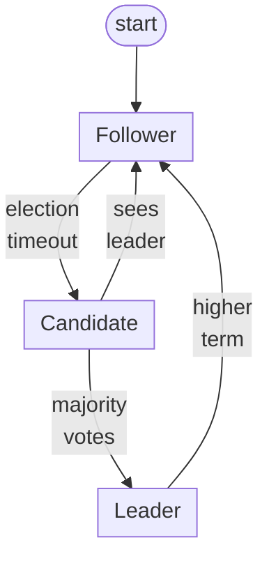
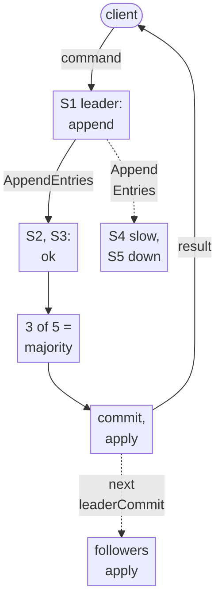
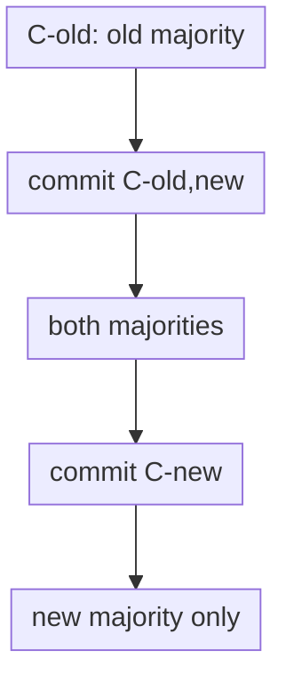

Dynamo keeps accepting writes on both sides of a network partition and merges the results later. Raft makes the opposite choice: the minority side stops, and the majority side never diverges. In 2014, Diego Ongaro and John Ousterhout described it in [In Search of an Understandable Consensus Algorithm](https://raft.github.io/raft.pdf). The conference version won Best Paper at [USENIX ATC ’14](https://www.usenix.org/conference/atc14/technical-sessions/presentation/ongaro). I’ll cite the extended version as **[Ongaro 2014]**, with section numbers. A few refinements come from Ongaro’s PhD thesis, [Consensus: Bridging Theory and Practice](https://web.stanford.edu/~ouster/cgi-bin/papers/OngaroPhD.pdf) (Stanford, August 2014), cited as **[thesis]**. Paragraphs marked **My take** are my own analysis.

## The problem: one log, many servers

Give every server the same deterministic state machine and the same sequence of commands, and every server ends up in the same state. That is a **replicated state machine** (§2). The hard part is keeping the log of commands identical everywhere, and that is the consensus algorithm’s job.

Section 2 lists what a practical consensus algorithm needs:

- **Safety under all non-Byzantine conditions.** It never returns an incorrect result despite “network delays, partitions, and packet loss, duplication, and reordering.”
- **Availability while any majority is up.** “A typical cluster of five servers can tolerate the failure of any two servers.”
- **No dependence on timing for consistency.** “Faulty clocks and extreme message delays can, at worst, cause availability problems.”
- **A slow minority doesn’t hurt.** A command completes once a majority has answered one round of RPCs.

Liveness can only be probabilistic. The thesis points to the FLP result: “no fault-tolerant consensus protocol can deterministically terminate in a purely asynchronous model.” While Raft’s timing assumptions don’t hold, “the cluster might not be able to elect a leader during that period (though safety will always be maintained)” [thesis, Ch. 9].

Why not just use Paxos? The authors call it “exceptionally difficult to understand,” and they needed “almost a year” to understand the full protocol themselves (§3). Its core agrees on a single value, and there is “no widely agreed-upon algorithm for multi-Paxos,” which is what a log needs. So Raft set **understandability** as its primary goal (§4). The authors split the problem into leader election, log replication and safety. They also shrank the state space: “logs are not allowed to have holes.”

## Leaders, terms and elections

Each server is a **follower**, a **candidate** or a **leader** (§5.1). The leader handles every client request, and followers only answer RPCs. Time is divided into **terms**, numbered with consecutive integers. Each term starts with an election and has at most one leader. Every RPC carries the sender’s term. A server that sees a higher term adopts it and steps down to follower, and a request with a stale term is rejected. That one rule is how a deposed leader that slept through an election finds out.

*Figure 1: Server states, based on Figure 4 of [Ongaro 2014]. A candidate that times out starts a new election, and any server that sees a higher term steps down. Layout is mine.*

A follower that hears nothing for an **election timeout** becomes a candidate (§5.2). It increments its term, votes for itself and sends `RequestVote` to everyone in parallel. Each server votes for at most one candidate per term, first come first served, so at most one leader can win in a term.

If everyone timed out at the same moment, split votes could repeat forever. Raft picks each timeout “randomly from a fixed interval (e.g., 150–300ms).” Usually one server times out first, wins, and starts sending heartbeats before anyone else wakes up. The authors first tried ranked candidates, but dropped them because they “created subtle issues around availability” (§5.2).

They measured how much randomness matters (§9.3). They repeatedly crashed the leader of a five-server cluster with a broadcast time of roughly 15ms:

- With no randomness, elections “consistently took longer than 10 seconds” because of repeated split votes.
- Just 5ms of randomness gave a median downtime of 287ms.
- 50ms of randomness gave a worst case of 513ms over 1000 trials.

Their recommendation is “a conservative election timeout such as 150–300ms.”

## Replicating the log

The leader appends the command to its log and sends `AppendEntries` to every follower in parallel. An entry is **committed** once the leader that created it has stored it on a majority. Committing an entry also commits every entry before it. The leader then applies the entry and answers the client. Followers learn the commit point from the `leaderCommit` field in later messages, heartbeats included (§5.3).

*Figure 2: One write, based on §5.3 of [Ongaro 2014]. The slow minority is retried in the background. Layout is mine.*

Each `AppendEntries` carries `prevLogIndex` and `prevLogTerm`, the position just before the new entries. A follower rejects the entries unless it already has a matching entry there. This **consistency check** gives the **Log Matching** property: if two logs contain an entry with the same index and term, the logs are identical in all entries up through that index (§5.3).

After a few crashes, a follower’s log can be missing entries, hold extra uncommitted entries, or both. The leader never changes its own log. When a follower rejects, the leader decrements that follower’s `nextIndex` and retries until the logs agree. The follower then deletes everything after that point and takes the leader’s entries.

## Safety: who may lead, and what counts as committed

Without one more rule, a follower that missed committed entries could become leader and overwrite them. So a voter refuses a candidate whose log is less up-to-date than its own: the later last term wins, and if the terms are equal, the longer log wins (§5.4.1). A winner needs a majority, and every committed entry lives on a majority. Any two majorities overlap, so the winner already holds every committed entry.

The subtlest rule is about old entries. A new leader cannot conclude that an entry from a previous term is committed just because it now sits on a majority. Figure 8 of the paper shows why. A term-2 entry reaches a majority, but a server whose last entry is from term 3 can still win an election and overwrite it. The rule is: “Raft never commits log entries from previous terms by counting replicas” (§5.4.2). Only current-term entries are committed by counting. Older ones are committed indirectly, through Log Matching, once a current-term entry after them reaches a majority.

**My take:** “replicated on a majority means committed” is the line you would naturally write. It is right for the current term and wrong for older ones. If you ever review a home-grown leader-based replication protocol, check that line first.

The paper names five properties that together guarantee every server applies the same command at each index (Figure 3):

| Property | What it says |
|---|---|
| Election Safety | At most one leader per term |
| Leader Append-Only | A leader never overwrites or deletes its own entries |
| Log Matching | Same index and term means identical logs up to that point |
| Leader Completeness | A committed entry is in every later leader’s log |
| State Machine Safety | No two servers apply different entries at the same index |

Timing matters only for liveness (§5.6): **broadcastTime ≪ electionTimeout ≪ MTBF**. The paper puts broadcast time at 0.5ms–20ms, depending on storage, so the election timeout is “likely to be somewhere between 10ms and 500ms.”

## Changing membership

Moving straight from the old configuration to the new one is unsafe. Servers switch at different moments, so two leaders could be elected in the same term, one by a majority of the old configuration and one by a majority of the new (§6). Raft goes through a joint configuration, **Cold,new**. While it is in force, elections and commits need separate majorities of both the old and the new sets. Configurations travel as ordinary log entries, and a server uses the latest one in its log as soon as it sees it.

*Figure 3: Two-phase membership change, based on Figure 11 of [Ongaro 2014]. Once Cold,new commits, every decision needs both majorities; once Cnew commits, only the new majority counts. Layout is mine.*

Three practical issues come up (§6). New servers join as non-voting members until they catch up. A leader that isn’t part of the new configuration steps down once it commits. Removed servers stop getting heartbeats, time out, and send `RequestVote` with ever-higher terms. The fix: “if a server receives a RequestVote RPC within the minimum election timeout of hearing from a current leader, it does not update its term or grant its vote.”

The thesis later recommends something simpler. Change “only one server can be added or removed from the cluster at a time,” so any old majority overlaps any new majority, and describes joint consensus “only for completeness” [thesis, Ch. 4]. The [etcd-io/raft](https://github.com/etcd-io/raft) library adds a guard: a change is “simply disallowed while any uncommitted change appears in the leader’s log.”

## Snapshots and clients

Logs can’t grow forever. Each server independently snapshots its committed state and discards the log prefix (§7). When a follower is so far behind that the leader has already discarded the entries it needs, the leader sends it a snapshot with `InstallSnapshot`. Having only the leader snapshot and ship the result “would waste network bandwidth and slow the snapshotting process.”

Raft aims for **linearizable** semantics (§8). Two details make that work:

- **Exactly-once writes.** A leader can commit a command and crash before replying, and the client will retry. So “clients assign unique serial numbers to every command,” and the state machine returns the cached response for a duplicate instead of running it again.
- **Reads that aren’t stale.** A leader that answers locally might already have been deposed without knowing it. So each new leader first commits a blank no-op entry, and it exchanges heartbeats with a majority before answering a read. A lease would skip that round trip, “but this would rely on timing for safety (it assumes bounded clock skew).”

The thesis calls this procedure **ReadIndex**: record the commit index, confirm leadership with one heartbeat round, wait until the state machine has applied up to that index, and then read [thesis, §6.4]. One heartbeat round can serve many queued reads. Ongaro does “not recommend” leases “unless necessary to meet performance requirements” [thesis, §6.4.1].

## Did it work?

The authors tested understandability directly (§9.1). 43 students at Stanford and Berkeley watched lectures on both algorithms and took a quiz on each. The mean scores were 25.7 for Raft and 20.8 for Paxos, out of 60. 33 of the 43 students scored higher on Raft. The authors list their own caveats: 15 students had prior Paxos experience, and the Paxos video was 14% longer.

Raft also shows up in production. The etcd-io/raft README says the library “powers distributed systems such as etcd, Kubernetes, Docker Swarm, Cloud Foundry Diego, CockroachDB, TiDB,” and more. A single group is limited by its leader, so large systems run many groups. CockroachDB splits data into ranges, “each with its own consensus group,” so “each node may be participating in hundreds of thousands of consensus groups.” To keep heartbeats from dominating, their MultiRaft layer has “each pair of nodes only… exchange heartbeats once per tick, no matter how many ranges they have in common” ([Darnell 2015](https://www.cockroachlabs.com/blog/scaling-raft/)).

## What still goes wrong: reads and locks

The thesis notes that “problems due to stale reads have already been discovered in two third-party Raft implementations” [thesis, §6.4]. Jepsen’s [etcd 3.4.3 analysis](https://jepsen.io/analyses/etcd-3.4.3) (2020) found that etcd’s key-value operations “appear to be strict serializable.” It also found that “etcd locks are fundamentally unsafe.” With two-second lease TTLs and process pauses, a lock-protected read-modify-write lost about 18% of acknowledged updates. A lock service must eventually expire a crashed holder’s lock, and a slow holder looks exactly like a crashed one. Jepsen recommends a monotonic fencing token that the protected resource checks itself.

**My take:** consensus makes the log correct. It does not make your clients’ view of time correct. Any lock, lease or leader-election API built on Raft still needs fencing at the resource.

## Raft vs Dynamo

| | Raft | Dynamo (2007) |
|---|---|---|
| During a partition | Only the majority side makes progress | Any reachable nodes accept writes |
| Who writes | One leader per term | Any node in the preference list |
| Ordering | One total order (log index) | Vector clocks, siblings |
| Conflicts | Impossible by construction | Expected; the app merges them |
| Scale-out | Shard into many groups | Consistent hashing |

**My take:** an even cluster size buys nothing. Four servers still need three for a majority, so they tolerate one failure, the same as three servers.

## Patterns worth stealing

- **Fence stale owners with an epoch.** A rising term on every message, plus “higher term wins, step down,” is the same idea as a fencing token.
- **Carry knowledge forward with overlapping majorities.** The election restriction plus majority commit means every new leader already has every committed entry.
- **Commit only what your own epoch can vouch for.** Old-epoch data becomes committed only behind a current-epoch entry.
- **Change membership through the log.** Make changes one server at a time, or in two phases, and let new members catch up before they vote.
- **Use timing for liveness, never for safety.** Treat leases as an explicit opt-in.
- **Make retries idempotent at every layer.** Idempotent RPCs aren’t enough; client commands need serial numbers too.

## A design question for you

Design a strongly consistent configuration-and-lock service for a company’s internal platform, deployed across three availability zones in one region. About 20,000 services read configuration keys constantly (reads outnumber writes by 50 to 1), and must never see a value older than one they have already seen. Writes must be linearizable and survive the loss of any one zone. The service also offers named locks, which batch jobs use to guard writes to external databases. Total data is around 200 GB, too large for one Raft group.

How do you split data into groups, and where do the voters live? Which read path do you pick, and what timing assumption does it make? How do you stop a lock holder that pauses for 30 seconds from corrupting the database? How do clients retry writes safely across leader changes? How do you replace a machine every week without downtime?

How would you answer, and where would you knowingly accept a timing assumption?

## Sources

Primary sources:

- Diego Ongaro and John Ousterhout, [In Search of an Understandable Consensus Algorithm (Extended Version)](https://raft.github.io/raft.pdf). Conference version: [USENIX ATC ’14](https://www.usenix.org/conference/atc14/technical-sessions/presentation/ongaro), Best Paper.
- Diego Ongaro, [Consensus: Bridging Theory and Practice](https://web.stanford.edu/~ouster/cgi-bin/papers/OngaroPhD.pdf), PhD thesis, Stanford University, August 2014.

Production and further reading:

- [etcd-io/raft](https://github.com/etcd-io/raft), README.
- Ben Darnell, [Scaling Raft](https://www.cockroachlabs.com/blog/scaling-raft/), Cockroach Labs, June 2015.
- Kyle Kingsbury, [Jepsen: etcd 3.4.3](https://jepsen.io/analyses/etcd-3.4.3), January 2020.
- [raft.github.io](https://raft.github.io/), with the RaftScope visualization, and [The Secret Lives of Data](https://thesecretlivesofdata.com/raft/), an animated walkthrough.
- Giuseppe DeCandia et al., [Dynamo: Amazon’s Highly Available Key-value Store](https://www.allthingsdistributed.com/files/amazon-dynamo-sosp2007.pdf), SOSP ’07, for the comparison.
