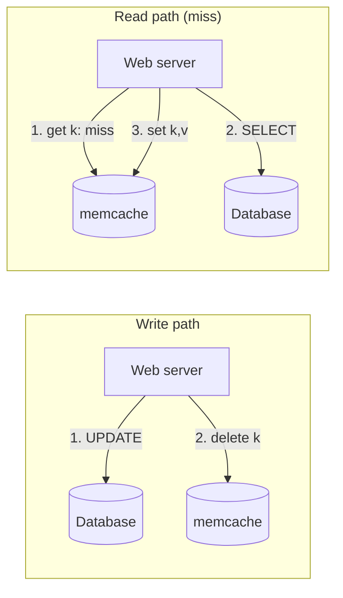
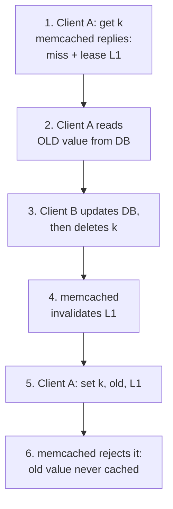
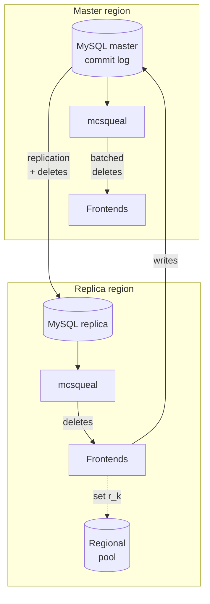

Memcached is just an in-memory hash table on one machine. In 2013, Facebook described how it turned that building block into a distributed cache that “handles billions of requests per second and holds trillions of items” for over a billion users. The paper is Rajesh Nishtala et al., [Scaling Memcache at Facebook](https://www.usenix.org/system/files/conference/nsdi13/nsdi13-final170_update.pdf), NSDI ’13. I’ll cite it as **[Nishtala 2013]**. Every Facebook-specific number and mechanism here comes from it and describes Facebook around 2013. Paragraphs marked **My take** are my own analysis.

The paper is organized by scale, and each scale has its own main problem: **latency and load** inside a cluster, **replication** inside a region, and **consistency** across regions.

## The problem and constraints

Two workload facts drive the design. Users “consume an order of magnitude more content than they create,” so reads dominate. And fan-out is huge: one popular page fetched an average of 521 distinct items from memcache, with a 95th percentile of 1,740.

Facebook also set two explicit goals. Every change must fix a user-facing or operational problem. And the probability of reading transient stale data is a parameter to tune: they will “expose slightly stale data in exchange for insulating a backend storage service from excessive load.”

**My take:** that second goal explains the whole paper. The cache isn’t authoritative and can drop anything, but at this scale a cold or failed cache means a database outage. Most of the mechanisms below protect the database.

## Look-aside caching: delete, don’t update

Memcache is a demand-filled look-aside cache. On a read, the web server asks memcache; on a miss it queries the database and sets the value. On a write, it updates the database and then **deletes** the key. Deletes are used instead of updates because they are idempotent.

*Figure 1: Redrawn from Figure 1 of [Nishtala 2013].*

## Inside a cluster: smart clients, dumb servers

A cluster has hundreds of memcached servers, and keys are spread by consistent hashing. So in a short period every web server talks to every memcached server. Memcached servers never talk to each other. The logic lives in a **stateless client**, either as a library or as a proxy called **mcrouter**.

- **Batching.** Application code builds a DAG of data dependencies to fetch as many keys in parallel as it can. Batches average 24 keys (§3.1).
- **UDP for gets.** Web threads send gets straight to memcached over UDP, skipping mcrouter. Dropped or reordered packets are errors with no recovery. At peak, 0.25% of gets are discarded. A failed get counts as a miss, and the client skips the follow-up set so it doesn’t load a struggling server. UDP was about 20% faster than TCP through mcrouter (§3.1).
- **TCP for sets and deletes.** These go through a local mcrouter, which also pools connections. A TCP connection from every web thread to every server would use too much memory.
- **Incast control.** If hundreds of replies arrive at once they can overwhelm rack and cluster switches. Clients use a sliding window of outstanding requests across all servers. The window grows slowly on success and shrinks when a request goes unanswered.

## Leases: stale sets and thundering herds

A **stale set** is when reordered concurrent updates leave an old value in the cache. A **thundering herd** is when a hot key keeps getting invalidated by writes and every reader falls through to the database.

On a miss, memcached gives the client a **lease**, a 64-bit token tied to the key. The set must include the token. If a delete arrived in the meantime, the token is invalid and the set is rejected. To handle herds, a server gives out at most one token per key every 10 seconds by default. Other readers are told to wait briefly and retry, and usually find the value already filled.

*Figure 2: The lease mechanism described in §3.2.1 of [Nishtala 2013], drawn as numbered steps. The sequence is illustrative.*

For a set of keys prone to herds, measured over a week, peak database queries dropped from **17K/s without leases to 1.3K/s with them** (§3.2.1). Deleted values also stay briefly in a recently-deleted area. A get can return them marked as stale, so apps that can tolerate it don’t have to wait.

## Pools and Gutter

Keys with different churn interfered with each other. Low-churn keys that were still useful got evicted before high-churn keys nobody read any more. So a cluster is split into **pools**: a default `wildcard` pool plus dedicated pools for awkward workloads. Some pools are **replicated**. When every request asks for all the keys on a server, splitting the keys across two servers leaves each still handling every request. Replicas halve the load instead.

When a server fails, automated remediation can take a few minutes, which is long enough for a cascade. About 1% of a cluster’s servers form a **Gutter** pool. A client that gets no response retries against Gutter and fills Gutter on a miss. Gutter entries expire quickly instead of being invalidated. Facebook avoided rehashing onto the remaining servers because one key can be 20% of a server’s traffic, and moving it could overload the next server. Gutter cut client-visible failures by 99% (§3.3).

## Regions and commit-log invalidation

Making one cluster bigger makes hot keys hotter and incast worse. So Facebook split web and cache servers into several **frontend clusters** that share one **storage cluster**. Together they form a **region**.

Invalidation comes from the database. SQL statements carry the memcache keys to delete after commit. A daemon called **mcsqueal** on each database reads committed statements and sends batched deletes to mcrouters in every frontend cluster, which route them to the right servers. Batching improved the median deletes per packet by 18× (§4.1). Having web servers broadcast deletes would batch worse, and when deletes went wrong, for example misrouted by a config error, it used to take a rolling restart of the whole fleet. Deletes stored in the commit log can simply be replayed.

Two more regional tools:

- **Regional pools** store data like large, rarely read items once per region instead of once per cluster. Cross-cluster links had 40% less average bandwidth (§4.2), so this only makes sense for low-traffic data.
- **Cold cluster warmup** lets an empty cluster fill misses from a warm cluster instead of the database, cutting ramp-up from days to hours (§4.3). Deletes in the cold cluster carry a two-second hold-off that rejects `add`. This stops a stale copy from the warm cluster from landing after a newer write.

*Figure 3: Components from Figures 2 and 6 and §4–5 of [Nishtala 2013]. The layout is mine.*

## Across regions: replica lag and remote markers

One region holds the master databases. The others hold read-only replicas kept up to date by MySQL replication. The model is “best-effort eventual consistency,” and the main problem is **replica lag**.

Commit-log invalidation fixes one race for free. If a master-region web server invalidated a replica region directly, the delete could arrive before the new data. Then a reader would refill the cache from the stale replica. With mcsqueal, each region’s deletes come from its own database, after the change has arrived.

For writes from a non-master region, Facebook uses **remote markers**. To update key `k`, the web server sets a marker `r_k` in a regional pool, writes to the master with both `k` and `r_k` marked for invalidation, and deletes `k` locally. On a later miss, if `r_k` exists, the read goes to the master region. That costs some latency on misses but makes stale reads less likely. The paper notes the gaps: concurrent writes can remove a marker another write still needs, and evicting a marker, unlike evicting a cache entry, does hurt consistency. Both are rare in practice.

## Tradeoffs and what they measured

| Choice | Cost | Benefit |
|---|---|---|
| Delete-on-write look-aside | A window of staleness | Idempotent invalidation; independent scaling |
| UDP gets, no retry | 0.25% of gets fail at peak | About 20% lower latency |
| Lease rate limiting | Readers wait or read stale | Peak DB load 17K/s → 1.3K/s on herd-prone keys |
| Gutter pool | About 1% extra servers, brief staleness | No hot-key cascade |
| mcsqueal invalidation | Extra pipeline and some lag | Batching, replay, correct cross-region order |
| Remote markers | Cross-region latency on some misses | Fewer stale reads after your own writes |

Facebook also checked invalidation directly. It sampled 1 in a million deletes and later checked whether the key was still cached. In the master region, deletes reached four 9s within 1 second and five 9s within an hour. Between replica regions, they reached three 9s within 1 second and four 9s within 10 minutes.

The paper’s closing lessons: separate cache from storage; treat monitoring and operability as seriously as performance; keep logic in stateless clients because stateful parts are harder to run; support gradual rollout and rollback; and “simplicity is vital.”

## Patterns worth stealing

- **Invalidate, don’t update.** Deletes are idempotent; racing updates leave the wrong value behind.
- **Guard refills with a token.** A lease fixes stale sets. Rate-limiting the lease fixes thundering herds.
- **Invalidate from the source of truth’s log.** It can be replayed, and it naturally arrives after replication.
- **Fail over to a spare, not to neighbors.** When load is skewed, a small spare pool with short TTLs is safer than rehashing.
- **Treat fan-out as a network problem.** Batch requests and use client-side congestion control.
- **Make staleness explicit and measure it.** Every window here has a number: 10-second leases, a two-second hold-off, quick Gutter expiry.

**My take:** the paper is honest that “many of the trade-offs discussed are not fundamental” and came from limited engineering resources on a live system. Copy the patterns, not the specific settings. In particular, UDP without retries depends on a network you control.

## A design question for you

Design the caching layer for a global “likes and comments” feature on a read-heavy social app. There’s one primary database region plus read replicas in three other regions. Replication lag is usually under a second but sometimes reaches tens of seconds. Viral posts get millions of reads per minute and thousands of likes per minute.

How do reads and writes interact with the cache? How do you keep each like on a viral post from causing a thundering herd? How does a user in a replica region see their own new comment right away? How do invalidations reach every region in the right order? And what happens when the cache server holding the viral post dies?

How would you answer, and which of Facebook’s 2013 choices would you change today?

## Sources

Primary source:

- Rajesh Nishtala, Hans Fugal, Steven Grimm, Marc Kwiatkowski, Herman Lee, Harry C. Li, Ryan McElroy, Mike Paleczny, Daniel Peek, Paul Saab, David Stafford, Tony Tung, Venkateshwaran Venkataramani, [Scaling Memcache at Facebook](https://www.usenix.org/system/files/conference/nsdi13/nsdi13-final170_update.pdf), 10th USENIX Symposium on Networked Systems Design and Implementation (NSDI ’13). [USENIX presentation page](https://www.usenix.org/conference/nsdi13/technical-sessions/presentation/nishtala).

Further reading:

- Meta Engineering, [Cache made consistent](https://engineering.fb.com/2022/06/08/core-infra/cache-made-consistent/) (2022), on how Meta later measured and improved cache consistency.
- Bronson et al., [TAO: Facebook’s Distributed Data Store for the Social Graph](https://www.usenix.org/conference/atc13/technical-sessions/presentation/bronson), USENIX ATC ’13.
