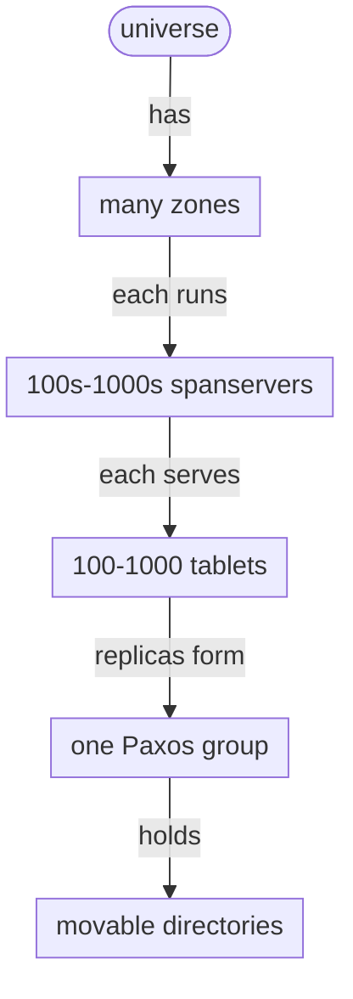
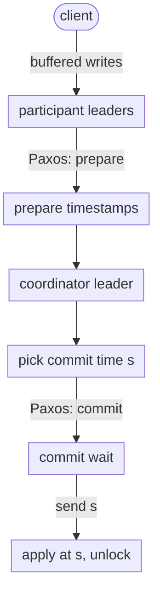
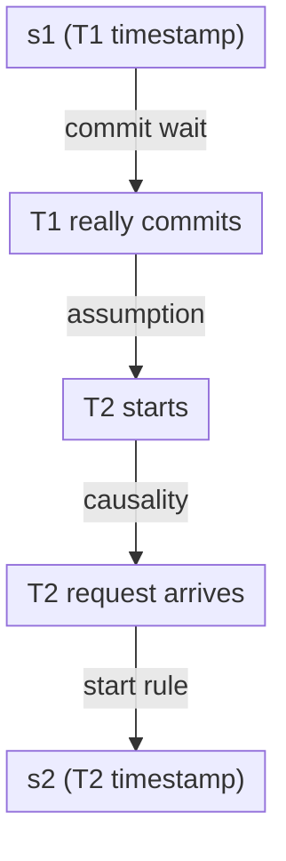

Raft and Paxos give you one ordered log per group of servers. A database that spans the planet needs thousands of those groups, and an order across all of them. Spanner, Google’s globally distributed database, gets that order from a clock. In 2012, James Corbett and 25 co-authors described it in [Spanner: Google’s Globally-Distributed Database](https://static.googleusercontent.com/media/research.google.com/en//archive/spanner-osdi2012.pdf), which won the Jay Lepreau Best Paper award at [OSDI ’12](https://www.usenix.org/conference/osdi12/technical-sessions/presentation/corbett). I’ll cite it as **[Corbett 2012]**, with section numbers. Two later sources show what changed: [Spanner: Becoming a SQL System](https://research.google/pubs/spanner-becoming-a-sql-system/) (SIGMOD ’17), cited as **[SQL ’17]**, and Eric Brewer’s [Spanner, TrueTime and the CAP Theorem](https://research.google/pubs/spanner-truetime-and-the-cap-theorem/) (2017), cited as **[Brewer]**. Paragraphs marked **My take** are my own analysis.

## The problem: Bigtable scaled, Megastore was consistent

Google’s Bigtable users kept asking for two things it didn’t have: support for “complex, evolving schemas” and “strong consistency in the presence of wide-area replication” (§1). Bigtable “only supports eventually-consistent replication across datacenters” and had no cross-row transactions (§2.3). Megastore had synchronous replication, so “at least 300 applications within Google use Megastore (despite its relatively low performance).” Without long-lived leaders, though, Megastore’s writes from different replicas conflict in Paxos, and “throughput collapses on a Paxos group at several writes per second” (§6).

The first customer made the pain concrete. F1, the rewrite of Google’s ads backend, ran on MySQL that was “manually sharded many ways,” and “the last resharding took over two years of intense effort” (§5.4).

So Spanner set out to do several things at once (§1, §2.3):

- **Scale** “up to millions of machines across hundreds of datacenters and trillions of database rows,” with automatic resharding.
- **Survive datacenter loss**, with applications choosing where replicas live and how many there are.
- **Offer general-purpose transactions** and a SQL-based query language.
- **Be externally consistent**: “if a transaction T1 commits before another transaction T2 starts, then T1’s commit timestamp is smaller than T2’s.”

That last property is the hard one. Inside one Paxos group, the log gives you order for free. Across groups there is no shared log, so “commits before” in real time has to become “smaller timestamp” some other way.

## The layout: zones, tablets, Paxos groups and directories

A deployment is a **universe** made of **zones**. A zone has a zonemaster, location proxies, and “between one hundred and several thousand” **spanservers** (§2). Each spanserver holds 100 to 1,000 **tablets**, each a bag of `(key, timestamp) → value` mappings stored on Colossus (§2.1).



*Figure 1: Spanner’s hierarchy, based on §2–2.2 of [Corbett 2012]. Layout is mine.*

Each tablet has **one Paxos state machine**, and its replicas across zones form a **Paxos group**. Leaders are long-lived, with time-based leases that default to 10 seconds. Writes go through the leader. Reads can go to “any replica that is sufficiently up-to-date.” The leader also runs a **lock table** for two-phase locking. Spanner chose pessimistic locking because long transactions “perform poorly under optimistic concurrency control in the presence of conflicts.” A **transaction manager** on the leader handles two-phase commit when a transaction spans groups. Single-group transactions, “as is the case for most transactions,” skip it (§2.1).

The unit of placement is the **directory**: “a set of contiguous keys that share a common prefix.” Spanner moves directories between groups to balance load or bring data closer to its users, and “a 50MB directory can be moved in a few seconds” (§2.2). The schema decides what goes together. A table marked `DIRECTORY` sits at the top, and child tables declared with `INTERLEAVE IN PARENT` store their rows next to the parent row with the same key prefix (§2.3):

```sql
CREATE TABLE Users {
  uid INT64 NOT NULL, email STRING
} PRIMARY KEY (uid), DIRECTORY;
CREATE TABLE Albums {
  uid INT64 NOT NULL, aid INT64 NOT NULL,
  name STRING
} PRIMARY KEY (uid, aid),
  INTERLEAVE IN PARENT Users ON DELETE CASCADE;
```

In F1, a directory is typically one ads customer, and more than 100 million directories had a single fragment, so their reads and writes “are guaranteed to occur on only a single server” (§5.4).

**My take:** interleaving is just choosing your partition key well, written into the schema. Spanner’s expensive machinery only runs when a transaction crosses directories, so a good schema is how you avoid paying for it.

## TrueTime: a clock that tells you how wrong it might be

TrueTime’s API is tiny (§3):

- `TT.now()` returns an interval `[earliest, latest]` guaranteed to contain the absolute time at which it was called.
- `TT.after(t)` is true if t has definitely passed.
- `TT.before(t)` is true if t has definitely not arrived.

The error bound ε is half the interval’s width. TrueTime uses GPS receivers and atomic clocks because they fail in different ways. Each datacenter has a set of time masters. Every machine runs a daemon that polls several masters and uses a variant of Marzullo’s algorithm “to detect and reject liars.” Between polls, the daemon assumes a worst-case drift of 200 µs per second. With a 30-second poll interval, plus about 1 ms of network delay to the masters, “ε is typically a sawtooth function of time, varying from about 1 to 7 ms over each poll interval,” and averages 4 ms (§3).

Is the bound trustworthy? Google’s machine statistics showed “bad CPUs are 6 times more likely than bad clocks” (§5.3). The tails still mattered. When two time masters at one datacenter were shut down for maintenance, ε rose for about an hour.

## Read-write transactions: two-phase commit over Paxos, then wait

Read-write transactions use two-phase locking. Writes are buffered at the client until commit. Reads take locks at group leaders, and wound-wait avoids deadlocks. To commit, the client picks a coordinator group and sends its buffered writes to every participant leader. Having the client drive the protocol “avoids sending data twice across wide-area links” (§4.2.1).



*Figure 2: A transaction that spans groups, based on §4.2.1 of [Corbett 2012]. Every prepare and commit record is a Paxos write. Layout is mine.*

The coordinator picks s so that it is at least every participant’s prepare timestamp, greater than `TT.now().latest` when the commit request arrived, and greater than any timestamp it has assigned before. Then comes the key step, **commit wait**: no replica applies the commit until `TT.after(s)` is true. “The expected wait is at least 2 ∗ ε̄,” where ε̄ is the average ε, and it “is typically overlapped with Paxos communication” (§4.2.1).

Why does that give external consistency? Section 4.1.2 proves it in four steps:



*Figure 3: The proof chain from §4.1.2 of [Corbett 2012]. Each arrow means “happens no later than.” The first two are strict, so s1 is smaller than s2. Layout is mine.*

Two more invariants make the timestamps trustworthy. Within a group, timestamps increase “even across leaders,” because a leader only assigns timestamps inside its lease, and lease intervals of successive leaders are disjoint. The appendix proves that disjointness with TrueTime instead of extra log writes (§4.1.1, Appendix A).

Brewer’s summary is the cleanest one: Spanner “gets serializability from locks, but it gets external consistency (similar to linearizability) from TrueTime” [Brewer].

## Reads without locks: safe time

Every replica tracks a **safe time**, “the maximum timestamp at which a replica is up-to-date,” and can serve a read at any timestamp up to it (§4.1.3). Safe time is the smaller of two values. One is the timestamp of the last applied Paxos write. The other is just below the earliest prepare timestamp of any transaction that is prepared but not yet committed, because that transaction’s fate is still unknown.

That makes three lock-free read types possible (§4.1):

- **Read-only transactions** pick a timestamp, then read at any up-to-date replica. If one group is involved, the leader uses the last committed write’s timestamp. Across groups, Spanner simply uses `TT.now().latest` and may wait for safe time to catch up (§4.2.2).
- **Snapshot reads** at a timestamp the client chooses.
- **Bounded-staleness reads**, where Spanner picks the timestamp within a bound the client gives.

Idle groups would never advance safe time, so leaders promise a floor for the next timestamp and advance it every 8 seconds by default. In the worst case, followers of an idle group can serve reads at timestamps “greater than 8 seconds old” (§4.2.4).

The same clock enables **atomic schema changes**. A normal transaction can’t do it, because the participants “could be in the millions.” Instead, the change is assigned a timestamp t in the future. Operations before t proceed, and later ones wait for the change. “Without TrueTime, defining the schema change to happen at t would be meaningless” (§4.2.3).

## What the numbers showed

The microbenchmarks used one spanserver per zone, datacenters within 1 ms of each other, and 4 KB operations (§5.1, Table 3):

| Replicas | Write latency (ms) | Snapshot read latency (ms) | Snapshot reads (Kops/s) |
| --- | --- | --- | --- |
| 1, no commit wait | 9.4 ± .6 | n/a | n/a |
| 1 | 14.4 ± 1.0 | 1.3 ± .1 | 13.5 ± .1 |
| 3 | 13.9 ± .6 | 1.2 ± .1 | 38.5 ± .3 |
| 5 | 14.4 ± .4 | 1.3 ± .04 | 50.0 ± 1.1 |

From the one-replica runs, commit wait is “about 5ms” and Paxos “about 9ms.” Snapshot-read throughput grows almost linearly with replicas, because any up-to-date replica can answer. Two-phase commit stayed reasonable up to 50 participants (mean 42.7 ms), and latencies “start to rise noticeably at 100 participants” (Table 4).

The availability test killed a whole zone that held every leader. With warning, leaders handed off and throughput dropped “around 3-4%.” Without warning, throughput dropped “almost to 0” until the 10-second leases expired. “Approximately 10 seconds after the kill time, all of the groups have leaders” (§5.2). The lease length is your worst-case unplanned failover time.

In F1 over 24 hours, reads averaged 8.7 ms, single-site commits 72.3 ms and multi-site commits 103.0 ms (Table 6).

## What changed later

By 2017, Spanner had “evolved into a relational database system,” and “in many ways today’s Spanner is very different” from the 2012 paper [SQL ’17]. It ran over 5,000 databases, served “tens of millions of QPS” and managed “hundreds of petabytes.” Requests are addressed to keys rather than servers, so moves and splits are hidden from clients. The storage format moved from Bigtable-style SSTables to a blockwise-columnar format called Ressi. TrueTime’s ε kept improving, which let query timestamp picking be skipped for reads at now plus epsilon.

Brewer added the CAP view. Spanner is “technically a CP system,” but with internal availability “better than 5 9s,” users effectively treat it as CA. He credits Google’s private network, not TrueTime: “TrueTime does not significantly help achieve CA.” Its real value, in his view, is consistent snapshots. A MapReduce over Bigtable sees “jagged” time across shards, while one over Spanner can “pick a precise timestamp and get repeatable and consistent results” [Brewer].

## Spanner vs Raft vs Dynamo

| | Spanner | Raft | Dynamo |
| --- | --- | --- | --- |
| Partition behaviour | CP; “effectively CA” in practice | CP; minority stops | AP; anyone reachable accepts writes |
| Order | Global timestamps that match real time | Log index in one group | Vector clocks and siblings |
| Multi-key transactions | Yes, across groups | Within one log | No |
| Role of clocks | Bounded, measured, waited out | Never needed for safety | Not used for ordering |

**My take:** Raft’s lease reads quietly assume bounded clock drift. Spanner takes that assumption seriously and builds infrastructure for it: the bound is an API value, liars are evicted, and a wider bound costs latency, not correctness. Don’t copy commit wait without a clock you can actually bound.

## Patterns worth stealing

- **Expose uncertainty in the API.** An interval forces every caller to decide what to do when the order is unclear.
- **Wait out uncertainty on the path that can afford it.** A few milliseconds on writes buys lock-free reads anywhere.
- **Make every 2PC participant a consensus group.** 2PC stays simple, and no single machine failure blocks it.
- **Put locality in the schema.** Interleaving keeps most transactions inside one group.
- **Track safe time per replica.** A replica that knows how current it is can serve consistent reads locally.
- **Agree on a future timestamp** for changes that must happen everywhere at once.

## A design question for you

Design a multi-region ledger for a payments company with users in India, the EU and the US. Each account has a home region for data residency, but transfers can go between any two accounts. A transfer must be atomic, and if transfer B starts after transfer A was acknowledged, every reader must see A before B. Auditors run an hourly “all balances sum to zero” check that must not block payments and must give the same answer when re-run. You must survive losing any one datacenter with no data loss. You have no atomic clocks, only a time-sync service whose error bound you can read but which sometimes spikes.

How do you shard and place accounts? Who coordinates a cross-region transfer, and how many WAN round trips does it cost? How do you assign timestamps, and what do you do when the clock bound spikes? Which timestamp and replicas does the audit use? How long is your leader lease?

Where would you accept extra write latency, and where would you refuse to?

## Sources

Primary sources:

- James C. Corbett et al., [Spanner: Google’s Globally-Distributed Database](https://static.googleusercontent.com/media/research.google.com/en//archive/spanner-osdi2012.pdf), OSDI ’12. Also on [USENIX](https://www.usenix.org/conference/osdi12/technical-sessions/presentation/corbett) and [Google Research](https://research.google/pubs/spanner-googles-globally-distributed-database-2/).
- David F. Bacon et al., [Spanner: Becoming a SQL System](https://research.google/pubs/spanner-becoming-a-sql-system/), SIGMOD ’17.
- Eric Brewer, [Spanner, TrueTime and the CAP Theorem](https://research.google/pubs/spanner-truetime-and-the-cap-theorem/), Google, February 2017.

Further reading:

- [Spanner: TrueTime and external consistency](https://cloud.google.com/spanner/docs/true-time-external-consistency), Cloud Spanner documentation.
- Alexander Thomson et al., [Calvin: Fast Distributed Transactions for Partitioned Database Systems](https://cs.yale.edu/homes/thomson/publications/calvin-sigmod12.pdf), SIGMOD ’12, which Spanner’s related work contrasts with its own approach.
- Diego Ongaro and John Ousterhout, [In Search of an Understandable Consensus Algorithm](https://raft.github.io/raft.pdf), and Giuseppe DeCandia et al., [Dynamo](https://www.allthingsdistributed.com/files/amazon-dynamo-sosp2007.pdf), for the comparison.
