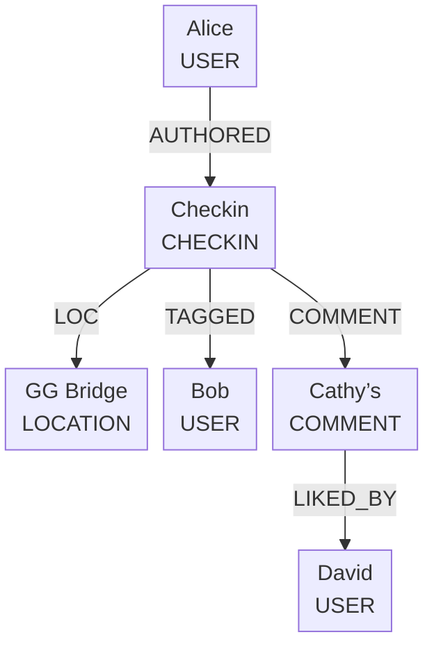
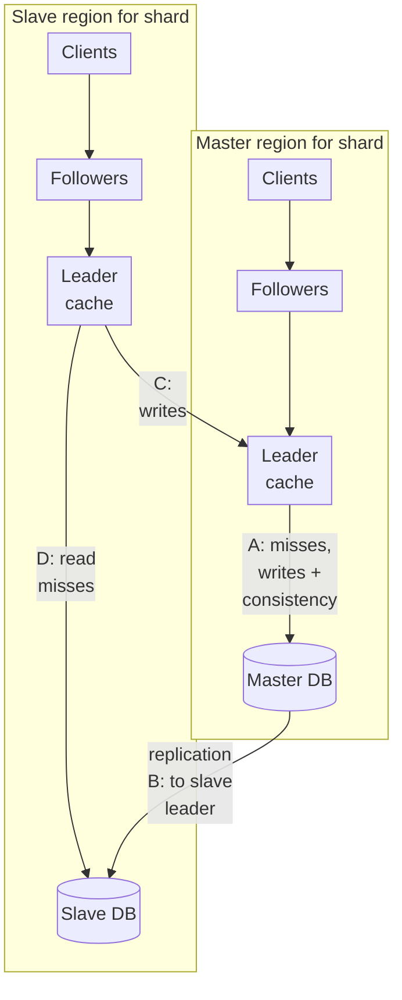

Facebook pages assemble hundreds of items from the social graph and privacy-filter every one for the current viewer. That makes write-time aggregation infeasible, so Facebook **pulls** the graph on each view. In 2013, Nathan Bronson and colleagues described **TAO**, the store built for that workload: [TAO: Facebook’s Distributed Data Store for the Social Graph](https://www.usenix.org/system/files/conference/atc13/atc13-bronson.pdf), USENIX ATC ’13 ([presentation page](https://www.usenix.org/conference/atc13/technical-sessions/presentation/bronson)). I’ll cite it as **[Bronson 2013]**. Every Facebook-specific number and mechanism here comes from it and describes Facebook around 2013. Paragraphs marked **My take** are my own analysis.

TAO “replac[es] memcache for many data types that fit its model,” runs on “thousands of machines,” holds “many petabytes,” and “can process a billion reads and millions of writes each second.”

## Why lookaside memcache failed for edges

Before TAO, web servers used MySQL plus memcache as a demand-filled lookaside cache (see [Nishtala et al., NSDI ’13](https://www.usenix.org/system/files/conference/nsdi13/nsdi13-final170_update.pdf) for that architecture). Three problems pushed Facebook to a graph-aware service (§2.1 of [Bronson 2013]):

1. **Edge lists are not key-value blobs.** Changing one edge forced reloading an entire cached list; concurrent incremental updates were hard to coordinate from clients.
2. **Control logic lived on clients.** Clients did not talk to each other, which increased the number of failure modes and made thundering herds hard to avoid. A fixed API lets the cache own that logic.
3. **Read-after-write across replica regions was expensive.** Async MySQL replication plus lookaside caches needed tricks like remote markers. Restricting the model to objects and associations lets TAO update replica caches at write time with graph-aware maintenance messages.

**My take:** TAO is not “memcache but bigger.” It is what you get when you stop pretending ordered, privacy-filtered edge lists are opaque strings.

## Objects, associations, and the list API

TAO models the graph as typed nodes and directed edges (§3):

- **Object:** `(id) → (otype, key→value pairs)`. Ids are **64-bit** and unique across types.
- **Association:** `(id1, atype, id2) → (time, key→value pairs)`. At most one association of a type between two objects. A **32-bit time** field (application-assigned) orders queries.

An **association list** is every edge with a given `(id1, atype)`, sorted **descending by time**. The API centers on `assoc_get`, `assoc_count`, `assoc_range`, and `assoc_time_range`. TAO caps `limit` per atype—**typically 6,000**—so longer lists need multiple queries (§3.4).

Bidirectional relationships are two associations. Types can declare an **inverse**; writes then couple to the inverse edge. Those two shard updates are **not atomic**. A failure can leave a forward without an inverse—a **hanging association**—repaired asynchronously (§4.2).

*Figure 1: Simplified from Figure 1b / §3 of [Bronson 2013]. FRIEND edges and Cathy’s USER object are omitted, and only one direction of each association pair is shown (for example LIKED_BY, whose inverse is David’s LIKES). Layout is mine.*

## Leaders, followers, and MySQL shards

Persistent storage is sharded MySQL. Object ids embed a shard id for life. Associations live on `id1`’s shard so each association query hits one server (§4.1).

The cache implements the full API. Servers form a **tier**. To avoid hot spots and quadratic all-to-all links, TAO splits caches into (§4.4):

- a **leader** tier per region that talks to the DB, serializes concurrent writes, avoids concurrent overlapping queries to the DB, and caps the number of pending queries to a shard; and
- multiple **follower** tiers that clients actually call. Followers forward misses and writes to the local leader.

Object updates send **invalidations** to followers. Association writes send **refill** messages instead: only contiguous prefixes of lists are cached, so a naive invalidate would truncate the list and throw away still-valid edges. A refill asks the leader to refresh the follower’s list (§4.4).

*Figure 2: Redrawn from Figure 2 / §4.5 of [Bronson 2013]. In the paper, B is its own path: consistency messages are delivered to the slave leader as the replication stream updates the slave DB. Here it is folded into the replication edge’s label. Mastership is chosen per shard. The paper says master/slave; Facebook’s engineering post on TAO uses primary/secondary.*

## Multi-region: local reads, remote writes

Follower read misses are **25× as frequent as writes**, so writes go to the master-DB region while read misses stay local (§4.5). Leaders always query the local DB. Consistency messages are **embedded in the DB replication stream** and delivered only after the slave has the transaction—earlier delivery would let a miss refill from stale durable state. TAO and memcache use the same delivery pipeline.

After a successful remote write, the local leader updates its cache immediately even if the slave DB has not caught up; followers will receive two invalidates or refills for that write, one when the write succeeds and one when its transaction is replicated to the local slave DB.

For the rare case that cannot tolerate lag, reads may be marked **critical** and proxied to the master region. The paper’s example is authentication, so replication lag can’t allow stale credentials (§6.1).

Hot shards use **shard cloning** across followers. Extremely hot items can sit in a small **client-side cache** with a version so unchanged replies omit the payload (§5.3).

## Consistency dial and measured numbers

Under normal operation TAO is **eventually consistent**, with **read-after-write within a single tier** when a request hits at most one failure (§6.1). Facebook’s engineering post describes the cache as **write-through** and says TAO “tries hard to guarantee with high probability that users always see their own updates” [[Marchukov 2013]](https://engineering.fb.com/2013/06/25/core-infra/tao-the-power-of-the-graph/). Slave regions have one more rare gap: if a fresh cached entry is evicted and reloaded from a slave DB that hasn’t caught up, “a client may observe a value go back in time in a single follower tier,” which the paper says is rare in practice (§6.1). Failover between follower tiers can break that guarantee if a read reaches the backup before the write’s refill or invalidate (§6.2).

Grounded measurements from the paper:

| Fact | Value | Where |
|---|---|---|
| Read / write mix | 99.8% / 0.2% | Figure 3 / §7 |
| `assoc_range` share of reads | 40.9% | Figure 3 / §7 |
| `assoc_get` finds an edge | 19.6% of calls | §7 |
| Overall hit rate for reads | 96.4% | §8 |
| Query failure rate (90 days, measured from the web server)* | 4.9×10⁻⁶ | §8 |
| Replication lag | <1s 85%, <3s 99%, <10s 99.8% | §8 |
| Write latency same region | avg 12.1 ms | Figure 9 / §8 |
| Write latency remote (58.1 ms RTT) | 74.4 = 58.1 + 16.3 ms | Figure 9 / §8 |

\* The paper cautions that one failed query can stop a client from issuing dependent queries, and that TAO’s failures may correlate with those of other systems (§8).

High-degree objects expose another trap: if more than ~6,000 edges of one type leave a node, the full list is not cached, so empty `assoc_get` answers cannot be proven from a prefix alone. The paper’s mitigations include querying the inverse direction and bounding search by creation time (§5.4).

**My take:** the interesting engineering is the pair of “refill for lists” and “consistency in the replication stream.” Together they preserve list prefixes and stop the classic invalidate-before-replicate race without requiring clients to run a distributed protocol.

## Patterns worth stealing

- **Cache the query shape, not opaque blobs.** Ordered association lists need refill and graph-aware answers (a zero count settles a range).
- **Leader for writes, followers for reads.** One serializer per shard; many tiers for read QPS.
- **Consistency traffic follows durable replication.** Maintenance after the replica has the row.
- **Default eventual, explicit critical path.** Most product traffic tolerates brief staleness; the paper’s example of a read that can’t is authentication.
- **Clone and version the hot path.** Hashing alone skews; cloning and tiny client caches absorb celebrities and viral posts (Facebook’s engineering post names “photos of celebrities” as items whose request rates spike [[Marchukov 2013]](https://engineering.fb.com/2013/06/25/core-infra/tao-the-power-of-the-graph/)).

## A design question for you

Design a multi-region social-graph store for posts, comments, likes, and friendships. Pages are assembled at read time with per-viewer privacy. Workload is about 99.8% reads. Lists are time-ordered; some objects have hundreds of thousands of edges of one type.

What is your object/association model for “latest N comments” and “does this edge exist?” How do you tier caches so writes serialize but reads scale? On an association write, do you invalidate or refill—and why? How does a replica region avoid filling a miss from a DB that has not seen the write yet? How do inverse edges and hanging associations work? Where do critical reads fit?

How would you answer, and which of Facebook’s 2013 choices would you change today?

## Sources

Primary source:

- Nathan Bronson, Zach Amsden, George Cabrera, Prasad Chakka, Peter Dimov, Hui Ding, Jack Ferris, Anthony Giardullo, Sachin Kulkarni, Harry Li, Mark Marchukov, Dmitri Petrov, Lovro Puzar, Yee Jiun Song, Venkat Venkataramani, [TAO: Facebook’s Distributed Data Store for the Social Graph](https://www.usenix.org/system/files/conference/atc13/atc13-bronson.pdf), 2013 USENIX Annual Technical Conference (ATC ’13). [USENIX presentation page](https://www.usenix.org/conference/atc13/technical-sessions/presentation/bronson).

Further reading:

- Rajesh Nishtala et al., [Scaling Memcache at Facebook](https://www.usenix.org/system/files/conference/nsdi13/nsdi13-final170_update.pdf), NSDI ’13 — lookaside background and shared invalidation pipeline.
- Mark Marchukov, [TAO: The power of the graph](https://engineering.fb.com/2013/06/25/core-infra/tao-the-power-of-the-graph/), Facebook Engineering, June 25, 2013 — write-through cache, seeing your own updates, and celebrity hot spots.
- Meta Engineering, [Cache made consistent](https://engineering.fb.com/2022/06/08/core-infra/cache-made-consistent/) (2022) — later work on measuring and fixing TAO cache-invalidation inconsistencies (Polaris and consistency tracing; by one measure, from six nines to ten nines).
